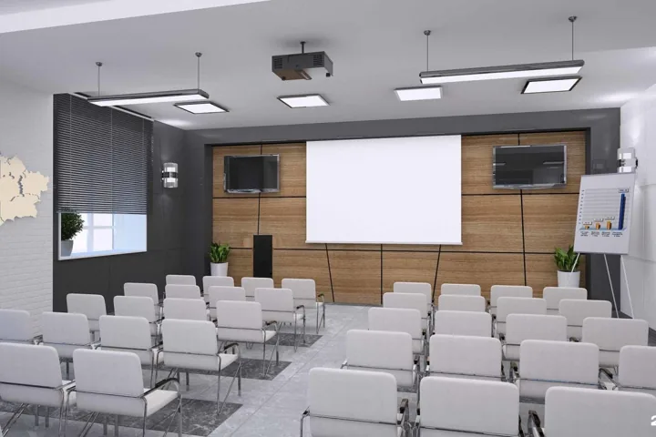
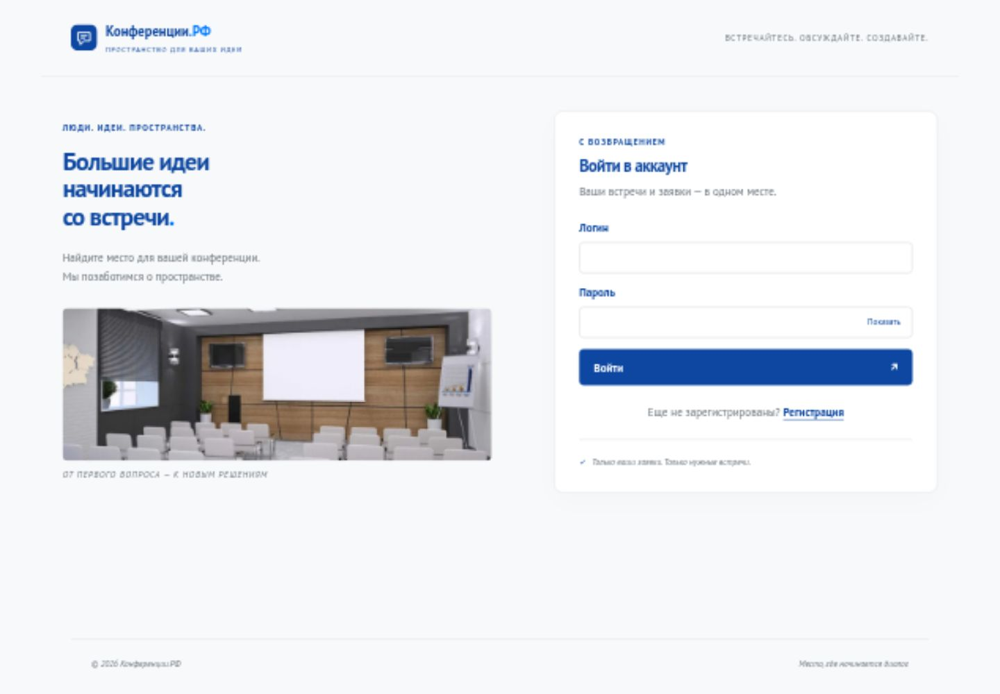
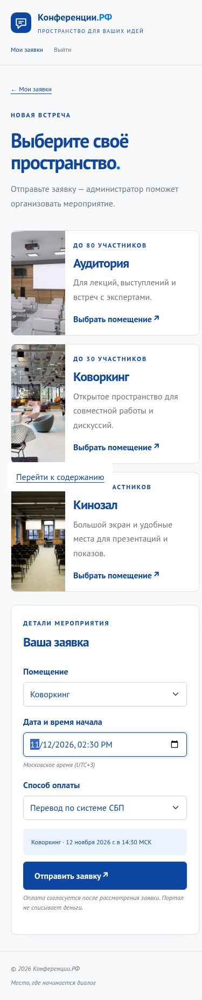
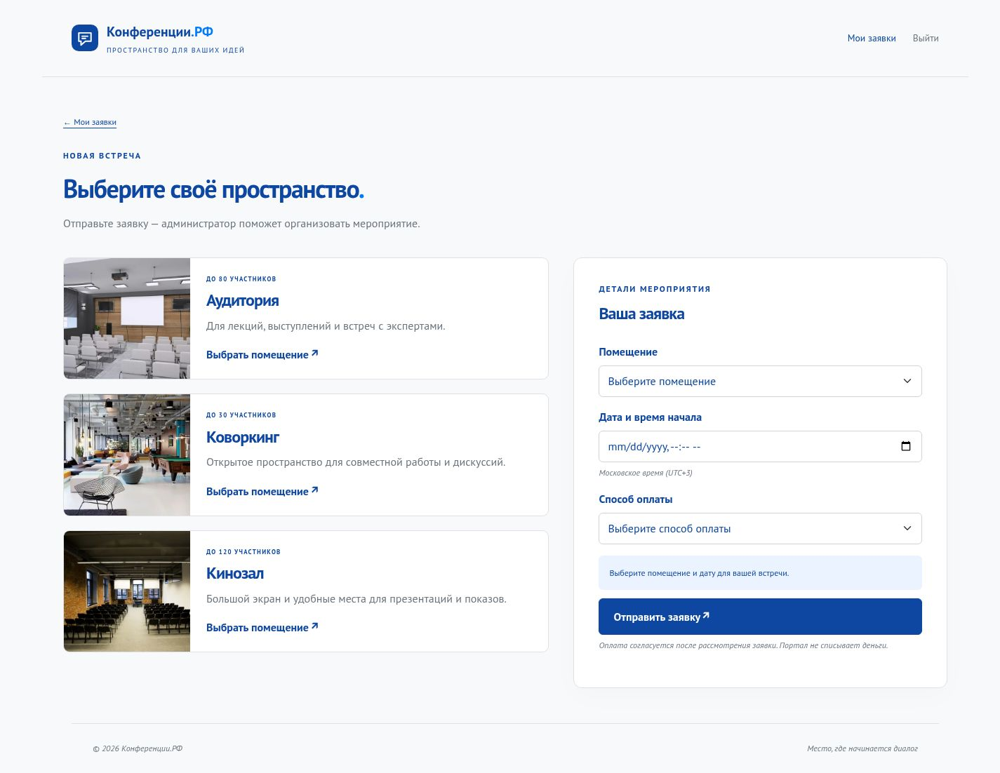
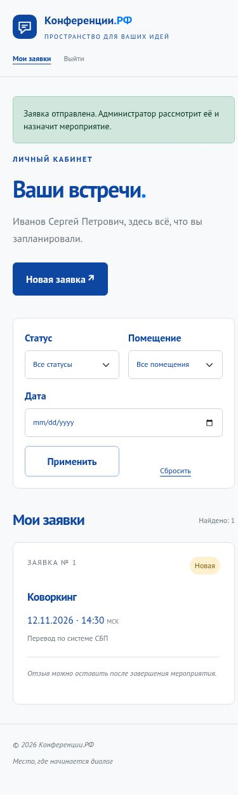
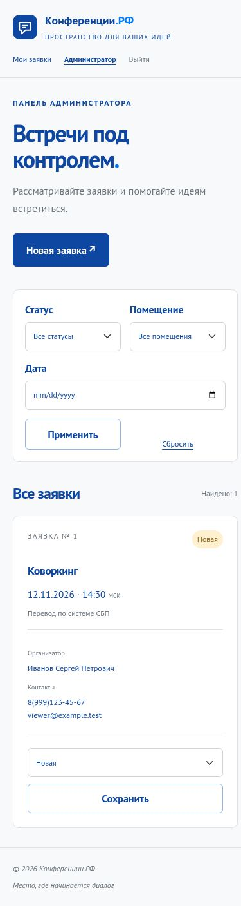
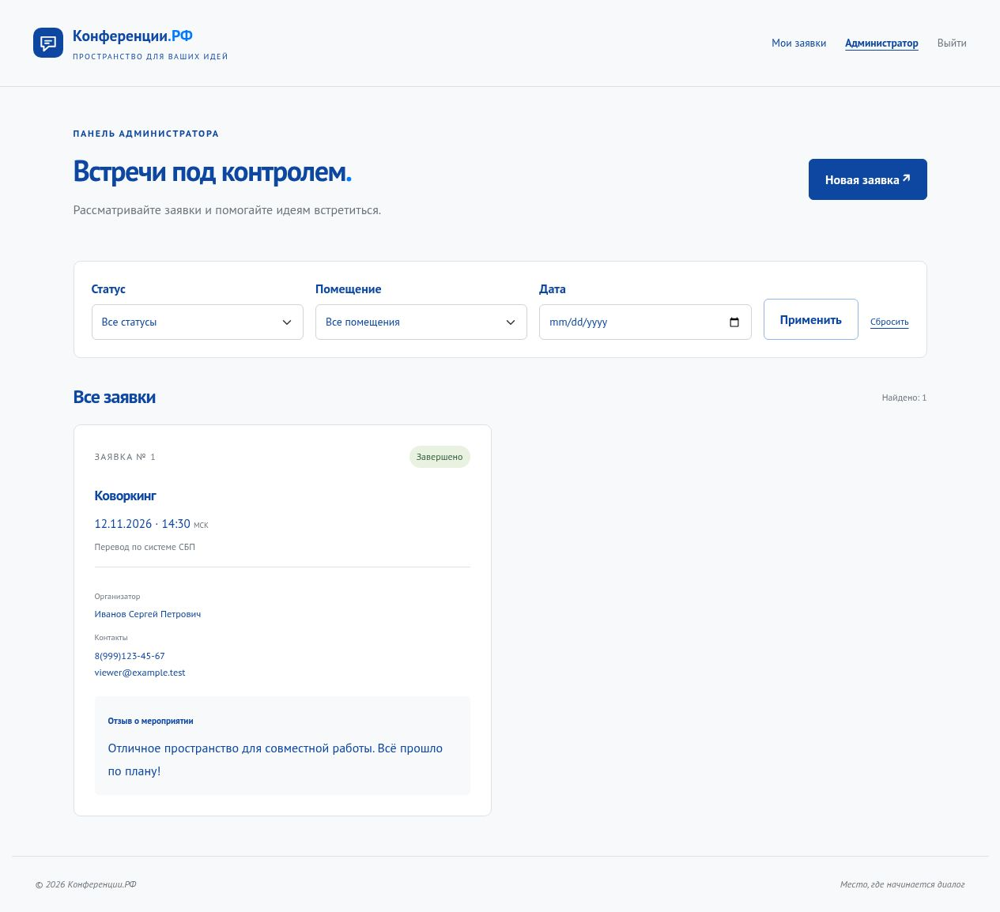
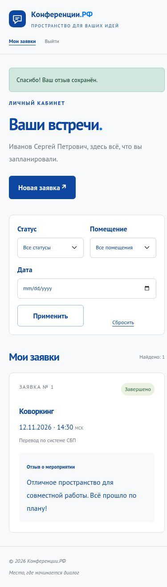

# Конференции.РФ — пошаговое решение 2027

КИМ 09.02.07-3-2027. Цель: опубликованные требования ГИА БУ на 75 баллов. Оценку выставляет эксперт. Вариативная часть не включена.

PHP 8.4 · PDO · MySQL 8.4 · Bootstrap 5.3.8 · JavaScript. Основной запуск на экзамене — обычный PHP/MySQL; Podman — тренировочная проверка.

72 раздела, 360 действий. Код ниже совпадает с файлами учебного проекта. GIMP здесь не запускался; описано самостоятельное выполнение по меню.

## Содержание

- [00. Рабочее место и маршрут на 75 баллов](#setup)

- [01. База данных и рабочее приложение](#application)

- [02. Дизайн, GIMP и мобильные страницы](#design)

- [03. Отзывы, интерактивность и сдача](#quality)

<a id="setup"></a>

## 00. Рабочее место и маршрут на 75 баллов

Разделяем подготовительный день, экзамен и домашнюю тренировку. На экзамене используем разрешённый локальный сервер; здесь приложение проверено в Podman.

КИМ: с. 7, 12–13, 29, 33–37; приложение: руководство по стилю.

### Что именно готовим

ConferencePortal решает образец «Конференции.РФ» на PHP 8.4, PDO и MySQL 8.4. Оформление использует локальный Bootstrap 5.3.8 и обычный JavaScript. Vue, Laravel, Tailwind и jQuery разрешены по условиям пользователя; этот вариант обходится без npm-сборки.

1. Откройте титульный лист КИМ и сверьте квалификацию, год и код со своим вариантом.
2. Выпишите отдельно требования к данным, страницам и правам, чтобы дизайн не заслонил функциональность.
3. Найдите таблицу времени: три задания занимают 90, 60 и 60 минут.
4. Выберите в методичке ПА для первого задания или ГИА для полного маршрута.
5. Скачайте учебный ZIP и прочитайте README; право принести готовые файлы на экзамен определяет площадка.

### Как читать 75 баллов

Таблица 7 содержит восемь групп критериев. Матрица docs/requirements.md связывает их с файлами и проверками; тесты подтверждают поведение, окончательную оценку ставят эксперты.

1. Откройте таблицу 7 на странице 13 КИМ.
2. Отметьте первый блок: разработка — 6, безопасность — 16, работа с информацией — 3.
3. Отметьте дизайн: стиль — 11, современные средства — 10, анализ требований — 4.
4. Отметьте третий блок: интерфейс — 15 и приложение — 10; сумма трёх блоков равна 75.
5. Для каждой группы найдите проверяемый результат в матрице; не распределяйте баллы между своими кнопками произвольно.

[Матрица опубликованных критериев](requirements.md)

### Подготовительный день

Заранее проверяют готовность среды и соединение. Экзаменационную БД проектируют в день экзамена; учебный импорт дома не заменяет это действие.

1. Получите у технического эксперта адрес MySQL, порт, пользователя и имя доступной базы.
2. Подключитесь предоставленным клиентом и выполните SELECT VERSION(), DATABASE(), CURRENT_USER().
3. Проверьте простой запрос без создания экзаменационных таблиц заранее.
4. Найдите локальные медиа, Bootstrap, справочник PHP и разрешённые библиотеки.
5. Проверьте доступ к индивидуальному Git и запишите адрес сайта и DocumentRoot.

### Локальный сервер: что должно быть установлено

На площадке могут быть Open Server, Apache/PHP или общий сервер. Не устанавливайте новое ПО самостоятельно. Нужны PHP 8.4 с pdo_mysql, MySQL и браузер.

1. Откройте терминал установленного PHP или терминал с уже настроенным PATH.
2. Выполните php -v и проверьте, что используется нужная копия PHP.
3. Выполните php -m и найдите PDO и pdo_mysql; отсутствие драйвера вызывает could not find driver.
4. Проверьте версию MySQL: CHECK в учебной схеме действует начиная с 8.0.16.
5. Выберите public как корень сайта, а на общем сервере уточните разрешённый путь публикации у эксперта.

### Создание рабочей папки

public содержит только публичные файлы; src — классы; views — шаблоны; sql — структуру БД; bin — команды; docs — доказательства результата.

1. В Проводнике создайте ConferencePortal в выданной рабочей директории.
2. В редакторе выберите Файл → Открыть папку и укажите ConferencePortal.
3. Создайте public/assets, src, views, sql, bin, docs и tests.
4. Включите показ расширений: index.php.txt не должен выглядеть как PHP-файл.
5. Создайте .gitignore и сохраняйте PHP в UTF-8 без BOM перед открывающим тегом.

**.gitignore — полный файл проверенного проекта**

```plain
config.local.php
.env
tests/results/
```

### Первый коммит

Git фиксирует реальные этапы работы. Для отправки на локальный сервер площадки GitHub и интернет не требуются.

1. В терминале проекта выполните git init, если репозиторий ещё не создан.
2. Задайте git config user.name и user.email для этого репозитория.
3. Добавьте .gitignore и начальную структуру, сделайте первый коммит.
4. Добавьте remote origin с адресом, выданным площадкой, и проверьте git remote -v.
5. Отправьте коммит разрешённым способом и убедитесь, что он появился на сервере.

### Разбор приложений

ZIP содержит фотографии, шрифты и руководство по стилю. Оригиналы хранятся отдельно от подготовленных ресурсов сайта.

1. Распакуйте исходный ZIP в отдельную папку и сохраните его без изменений.
2. Откройте руководство по стилю, выпишите палитру и размеры текста.
3. Из PT_Sans.zip извлеките Regular, Bold, Italic и лицензию OFL.
4. Просмотрите миниатюры и выберите три фотографии разных пространств.
5. Запишите исходные имена, разрешение и размер выбранных файлов для таблицы оптимизации.

### Настройки соединения

Database::connect читает учебные значения, затем config.local.php, затем переменные окружения. Контейнерное имя spravka-web-db нельзя переносить на обычный локальный сервер.

1. Скопируйте config.example.php в config.local.php в корне проекта.
2. Укажите выданный адрес MySQL; 127.0.0.1 подходит только для БД на этом компьютере.
3. Укажите порт, имя доступной базы, пользователя и пароль своей среды.
4. Оставьте config.local.php вне Git, а пример конфигурации сохраните без настоящих секретов.
5. Если использовали Podman, проверьте, что в локальном терминале не осталось DB_HOST=spravka-web-db.

**config.example.php — полный файл проверенного проекта**

```php
<?php
// Copy to config.local.php on a local exam server. Do not commit real credentials.
return [
    'host' => '127.0.0.1', 'port' => '3306', 'database' => 'conference_portal',
    'user' => 'conference', 'password' => 'conference_dev',
];
```

**src/Database.php — полный файл проверенного проекта**

```php
<?php
declare(strict_types=1);
namespace Conference;

use PDO;

final class Database
{
    public static function connect(): PDO
    {
        $config = ['host'=>'127.0.0.1', 'port'=>'3306', 'database'=>'conference_portal',
            'user'=>'conference', 'password'=>'conference_dev'];
        if (is_file(__DIR__.'/../config.local.php')) {
            $config = array_replace($config, require __DIR__.'/../config.local.php');
        }
        foreach ($config as $key => &$value) {
            $env = getenv('DB_'.strtoupper($key));
            if ($env !== false) $value = $env;
        }
        unset($value);
        return new PDO("mysql:host={$config['host']};port={$config['port']};dbname={$config['database']};charset=utf8mb4",
            $config['user'], $config['password'], [
                PDO::ATTR_ERRMODE => PDO::ERRMODE_EXCEPTION,
                PDO::ATTR_DEFAULT_FETCH_MODE => PDO::FETCH_ASSOC,
                PDO::ATTR_EMULATE_PREPARES => false,
            ]);
    }
}
```

### Создание БД в Workbench или phpMyAdmin

Учебная схема не удаляет БД и не выбирает за вас её имя. Инициализация работает с уже существующей выбранной базой.

1. В Workbench создайте Schema conference_portal с utf8mb4, либо используйте имя площадки.
2. В phpMyAdmin аналогичное действие находится в Базы данных → Создать; на общем сервере его может выполнять эксперт.
3. Выдайте приложению права только на учебную БД, не используйте серверный root.
4. Сверьте имя схемы с config.local.php и выполните php bin/init.php из корня проекта.
5. Обновите список таблиц: должны появиться users, rooms, bookings и reviews.

**bin/init.php — полный файл проверенного проекта**

```php
<?php
declare(strict_types=1);
require __DIR__.'/../src/bootstrap.php';
if (PHP_SAPI !== 'cli') { http_response_code(404); exit; }
$db = Conference\Database::connect();
$db->exec(file_get_contents(__DIR__.'/../sql/schema.sql'));
$admin = $db->prepare('INSERT IGNORE INTO users (login,password_hash,full_name,phone,email,role) VALUES (?,?,?,?,?,?)');
$admin->execute(['Conf2027', password_hash('Demo77', PASSWORD_DEFAULT), 'Администратор портала',
    '8(999)000-00-00', 'admin@conference.test', 'admin']);
$room = $db->prepare('INSERT INTO rooms (name,description,image,capacity) VALUES (?,?,?,?) ON DUPLICATE KEY UPDATE description=VALUES(description),image=VALUES(image),capacity=VALUES(capacity)');
foreach ([
    ['Аудитория','Для лекций, выступлений и встреч с экспертами.','auditorium.webp',80],
    ['Коворкинг','Открытое пространство для совместной работы и дискуссий.','coworking.webp',30],
    ['Кинозал','Большой экран и удобные места для презентаций и показов.','cinema.webp',120],
] as $data) $room->execute($data);
echo "Готово: 4 таблицы, 3 помещения. Администратор Conf2027 / Demo77.\n";
```

### Запуск без контейнеров

Встроенный сервер PHP подходит для тренировки на настроенной машине. На экзамене используйте сервер площадки; контейнеры не обязательны.

1. В терминале перейдите в корень ConferencePortal, где находится public.
2. Выполните php -S 127.0.0.1:8080 -t public и оставьте терминал открытым.
3. Откройте http://127.0.0.1:8080/; PHP нельзя проверять двойным щелчком через file://.
4. Для Apache укажите DocumentRoot на public и используйте назначенный локальный домен.
5. Проверьте страницу входа и локальные ресурсы, затем ?page=missing с понятным ответом 404.

### Podman для домашней проверки

Здесь PHP и MySQL запускаются только в контейнерах. MySQL не публикует порт, HTTP доступен только на 127.0.0.1:8087. Это дополнительный способ тренировки.

1. Из репозитория перейдите в examples/ConferencePortal.
2. Выполните bash bin/podman.sh up; первый запуск скачает официальные образы и соберёт драйвер PDO.
3. Дождитесь сообщения о четырёх таблицах и откройте http://127.0.0.1:8087/.
4. Проверьте вход администратора Conf2027 / Demo77.
5. Останавливайте через bash bin/podman.sh down: удалятся только контейнеры проекта, данные в томе сохранятся.

**Containerfile — полный файл проверенного проекта**

```plain
FROM docker.io/library/php:8.4-apache
RUN docker-php-ext-install pdo_mysql
COPY . /var/www/portal
ENV APACHE_DOCUMENT_ROOT=/var/www/portal/public
RUN sed -ri 's!/var/www/html!/var/www/portal/public!g' /etc/apache2/sites-available/*.conf /etc/apache2/apache2.conf /etc/apache2/conf-available/*.conf
WORKDIR /var/www/portal
```

**bin/podman.sh — полный файл проверенного проекта**

```bash
#!/usr/bin/env bash
set -euo pipefail
cd "$(dirname "$0")/.."
case "${1:-up}" in
  up)
    podman network exists spravka-web-net || podman network create spravka-web-net >/dev/null
    podman volume exists spravka-web-data || podman volume create spravka-web-data >/dev/null
    podman build -q -t localhost/spravka-conference:dev .
    if ! podman container exists spravka-web-db; then
      podman run -d --name spravka-web-db --network spravka-web-net \
        -e MYSQL_ROOT_PASSWORD=local_root_dev -e MYSQL_DATABASE=conference_portal \
        -e MYSQL_USER=conference -e MYSQL_PASSWORD=conference_dev \
        -v spravka-web-data:/var/lib/mysql docker.io/library/mysql:8.4 >/dev/null
    else podman start spravka-web-db >/dev/null; fi
    ready=false
    for attempt in {1..90}; do
      if podman exec -e MYSQL_PWD=conference_dev spravka-web-db mysql -uconference -Dconference_portal -e 'SELECT 1' >/dev/null 2>&1; then ready=true; break; fi
      sleep 1
    done
    if [[ "$ready" != true ]]; then echo 'MySQL не готов. Проверьте podman logs spravka-web-db.' >&2; exit 1; fi
    if ! podman container exists spravka-web-app; then
      podman run -d --name spravka-web-app --network spravka-web-net \
        -p "127.0.0.1:${PORT:-8087}:80" -e DB_HOST=spravka-web-db \
        -e DB_DATABASE=conference_portal -e DB_USER=conference -e DB_PASSWORD=conference_dev \
        -v "$PWD:/var/www/portal:ro" localhost/spravka-conference:dev >/dev/null
    else podman start spravka-web-app >/dev/null; fi
    podman exec spravka-web-app php bin/init.php
    echo "Портал: http://127.0.0.1:${PORT:-8087}/"
    ;;
  down)
    for container in spravka-web-app spravka-web-db; do
      if podman container exists "$container"; then podman stop "$container" >/dev/null; podman rm "$container" >/dev/null; fi
    done
    echo 'Контейнеры удалены. Данные сохранены в томе spravka-web-data.'
    ;;
  *) echo 'Использование: bash bin/podman.sh up|down' >&2; exit 2 ;;
esac
```

### Если запуск не удался

Разделяйте ошибки окружения, соединения и программы. Страница 503 скрывает внутренние подробности, полное исключение находится в серверном журнале.

1. При could not find driver проверьте pdo_mysql именно того PHP, который обслуживает сайт.
2. При Access denied проверьте пользователя, пароль и разрешённый хост подключения.
3. При Unknown database создайте схему или исправьте имя в конфигурации.
4. При Table does not exist выполните init.php с теми же настройками, что использует сайт.
5. При пропавших стилях проверьте public/assets и DocumentRoot; в Podman читайте logs только своих app и db.

### Как запрос проходит по проекту

Браузер → index.php → Portal → репозиторий → MySQL → шаблон. ООП разделяет обязанности вместо одного файла со всеми SQL и HTML.

1. В public/index.php найдите запуск сессии, заголовки и создание Portal.
2. В src/bootstrap.php найдите автозагрузчик классов Conference.
3. Проследите в Portal::run обработку GET, POST и неизвестного маршрута.
4. Убедитесь, что SQL находится в репозиториях, а общий HTML — в layout.php.
5. Проследите один путь целиком: форма заявки → post booking → create → redirect dashboard.

**public/index.php — полный файл проверенного проекта**

```php
<?php
declare(strict_types=1);
require __DIR__.'/../src/bootstrap.php';

ini_set('session.use_strict_mode', '1');
session_set_cookie_params(['httponly'=>true, 'samesite'=>'Lax', 'secure'=>!empty($_SERVER['HTTPS']) && $_SERVER['HTTPS'] !== 'off']);
session_start();
$_SESSION['csrf'] ??= bin2hex(random_bytes(32));
header('X-Content-Type-Options: nosniff');
header('X-Frame-Options: DENY');
header('Referrer-Policy: same-origin');
header('Cache-Control: no-store');

try {
    (new Conference\Portal(Conference\Database::connect()))->run();
} catch (Throwable $exception) {
    error_log((string)$exception);
    http_response_code(503);
    echo '<!doctype html><html lang="ru"><meta charset="utf-8"><title>Сервис временно недоступен</title><h1>Не удалось открыть портал</h1><p>Проверьте подключение к базе и выполнение bin/init.php. Обновите страницу после восстановления сервиса.</p></html>';
}
```

**src/bootstrap.php — полный файл проверенного проекта**

```php
<?php
declare(strict_types=1);

date_default_timezone_set('Europe/Moscow');
spl_autoload_register(function (string $class): void {
    $prefix = 'Conference\\';
    if (str_starts_with($class, $prefix)) {
        $file = __DIR__.'/'.substr($class, strlen($prefix)).'.php';
        if (is_file($file)) require $file;
    }
});

function e(mixed $value): string { return htmlspecialchars((string)$value, ENT_QUOTES | ENT_SUBSTITUTE, 'UTF-8'); }
function input(string $key, bool $trim = true): string {
    $value = $_POST[$key] ?? '';
    return is_string($value) ? ($trim ? trim($value) : $value) : '';
}
function getValue(string $key): string {
    $value = $_GET[$key] ?? '';
    return is_string($value) ? trim($value) : '';
}
function redirect(string $page): never { header('Location: index.php?page='.$page, true, 303); exit; }
function csrf(): string { return '<input type="hidden" name="csrf" value="'.e($_SESSION['csrf']).'">'; }
```

**views/message.php — полный файл проверенного проекта**

```php
<section class="empty-state"><h1><?= e($title) ?></h1><p><?= e($message) ?></p><a class="btn btn-primary" href="index.php">На главную</a></section>
```

### Версии и перенос на площадку

Учебный архив содержит проверенный набор файлов, но пути и учётные данные всегда зависят от среды. Не меняйте структуру вслепую при переносе.

1. Запишите php -v и SELECT VERSION() в свой отчёт.
2. Проверьте, что сервер обрабатывает PHP 8.4, а не старый модуль.
3. Сверьте корень сайта и относительные адреса assets после копирования.
4. Заполните собственный config.local.php, не изменяя учебные исходники под секреты.
5. Повторите короткий сценарий входа и заявки именно на том сервере, где будете показывать результат.

### План времени и контрольные точки

Сначала работающий сценарий, затем оформление. Внутреннее распределение минут — тренировочный ориентир, а не дополнительное правило КИМ.

1. В начале первого задания спроектируйте схему, импортируйте её и сохраните ER.
2. Затем реализуйте регистрацию, вход и права; завершите заявки и состояния до конца 90 минут.
3. Во втором задании примените стиль ко всем страницам, затем проверьте мобильный экран и графику.
4. В третьем завершите отзывы, интерактивность, фильтры и негативные проверки.
5. Оставьте время на итоговый просмотр файлов, коммит и проверку отправки на сервер.

### Проверка готовности

Подготовка завершена, когда вы понимаете структуру решения и можете объяснить, как запускать его в своей среде.

1. Откройте все папки проекта и объясните назначение каждой.
2. Найдите настройки соединения и убедитесь, что секреты исключены из Git.
3. Откройте исходное руководство по стилю и таблицу критериев.
4. Проверьте доступ к исходникам и материалам без внешнего интернета.
5. Начинайте первое задание только после того, как понятны адрес сайта, база и способ сдачи.

### Чек-лист

- [ ] Различаю ПА (25 баллов) и ГИА БУ (75); вариативную часть не заменяю выдуманным заданием.
- [ ] Проверены PHP, pdo_mysql, MySQL и адрес сервера.
- [ ] Сохранены приложения, известны требования к стилю и графике.
- [ ] Создана структура файлов и проверен доступ к индивидуальному репозиторию.
- [ ] Podman понимаю как тренировочную среду, а не требование экзамена.

<a id="application"></a>

## 01. База данных и рабочее приложение

Собираем полный сценарий: пользователь регистрируется и создаёт заявку, администратор видит её и меняет статус. Все изменения проверяет сервер.

КИМ: с. 29–35; первый блок: 6 + 16 + 3 = 25 баллов.

### Сущности и границы системы

Модель содержит пользователя, помещение, заявку и отзыв. Заявка представляет планируемое мероприятие; способ оплаты фиксируется, реальные деньги портал не переводит.

1. Выпишите поля регистрации и отдельную роль доступа пользователя.
2. Опишите справочник помещений: название, описание, изображение, вместимость.
3. Для заявки запишите владельца, помещение, начало, оплату и статус.
4. Для отзыва оставьте ссылку на заявку, текст и время создания.
5. Сопоставьте каждое поле с формой ввода и местом отображения, не дублируйте названия в разных таблицах.

### Ключи, связи и нормализация

users → bookings и rooms → bookings: один ко многим. bookings → reviews: максимум один отзыв благодаря UNIQUE. Владелец отзыва определяется через заявку.

1. Назначьте каждой сущности первичный ключ id.
2. Добавьте bookings.user_id и room_id с тем же типом INT UNSIGNED, что у родителей.
3. Добавьте reviews.booking_id с FOREIGN KEY и UNIQUE.
4. Оставьте ограничение удаления связанных данных, пока вариант не требует другого сценария.
5. Нарисуйте кардинальности и объясните, почему reviews не нужен второй user_id.

### Создание таблиц

sql/schema.sql рассчитан на выбранную схему MySQL. Отсутствие DROP защищает существующие данные от случайного удаления.

1. Выберите свою Schema двойным щелчком в Workbench или через USE.
2. Откройте schema.sql и выполните целиком.
3. Обновите таблицы и проверьте четыре ожидаемых имени.
4. Сравните типы, первичные ключи, UNIQUE и FOREIGN KEY с файлом.
5. Сохраните SQL в рабочем репозитории: таблицы только на сервере не заменяют исходник.

**sql/schema.sql — полный файл проверенного проекта**

```sql
-- Import into an empty database selected in MySQL / phpMyAdmin / Workbench.
-- No DROP, no hard-coded database name; MySQL 8.0.16+ enforces CHECK.
CREATE TABLE IF NOT EXISTS users (
    id INT UNSIGNED AUTO_INCREMENT PRIMARY KEY,
    login VARCHAR(64) CHARACTER SET ascii COLLATE ascii_general_ci NOT NULL UNIQUE,
    password_hash VARCHAR(255) NOT NULL,
    full_name VARCHAR(150) NOT NULL,
    phone VARCHAR(16) NOT NULL,
    email VARCHAR(254) NOT NULL,
    role ENUM('user','admin') NOT NULL DEFAULT 'user',
    created_at TIMESTAMP NOT NULL DEFAULT CURRENT_TIMESTAMP
) ENGINE=InnoDB DEFAULT CHARSET=utf8mb4 COLLATE=utf8mb4_unicode_ci;

CREATE TABLE IF NOT EXISTS rooms (
    id INT UNSIGNED AUTO_INCREMENT PRIMARY KEY,
    name VARCHAR(100) NOT NULL UNIQUE,
    description VARCHAR(400) NOT NULL,
    image VARCHAR(100) NOT NULL,
    capacity SMALLINT UNSIGNED NOT NULL
) ENGINE=InnoDB DEFAULT CHARSET=utf8mb4 COLLATE=utf8mb4_unicode_ci;

CREATE TABLE IF NOT EXISTS bookings (
    id INT UNSIGNED AUTO_INCREMENT PRIMARY KEY,
    user_id INT UNSIGNED NOT NULL,
    room_id INT UNSIGNED NOT NULL,
    starts_at DATETIME NOT NULL,
    payment ENUM('onsite','sbp') NOT NULL,
    status ENUM('new','assigned','completed') NOT NULL DEFAULT 'new',
    created_at TIMESTAMP NOT NULL DEFAULT CURRENT_TIMESTAMP,
    CONSTRAINT fk_bookings_user FOREIGN KEY (user_id) REFERENCES users(id),
    CONSTRAINT fk_bookings_room FOREIGN KEY (room_id) REFERENCES rooms(id),
    INDEX ix_bookings_owner (user_id, id),
    INDEX ix_bookings_status_date (status, starts_at),
    INDEX ix_bookings_room (room_id, starts_at)
) ENGINE=InnoDB DEFAULT CHARSET=utf8mb4 COLLATE=utf8mb4_unicode_ci;

CREATE TABLE IF NOT EXISTS reviews (
    id INT UNSIGNED AUTO_INCREMENT PRIMARY KEY,
    booking_id INT UNSIGNED NOT NULL UNIQUE,
    body VARCHAR(2000) NOT NULL,
    created_at TIMESTAMP NOT NULL DEFAULT CURRENT_TIMESTAMP,
    CONSTRAINT fk_reviews_booking FOREIGN KEY (booking_id) REFERENCES bookings(id),
    CONSTRAINT ck_reviews_body CHECK (CHAR_LENGTH(TRIM(body)) BETWEEN 1 AND 2000)
) ENGINE=InnoDB DEFAULT CHARSET=utf8mb4 COLLATE=utf8mb4_unicode_ci;
```

### ER-диаграмма в MySQL Workbench

КИМ требует сохранённую ER. SVG в архиве объясняет модель; на экзамене постройте диаграмму по своей действующей БД.

1. Выберите Database → Reverse Engineer и рабочее соединение.
2. На шаге выбора схем отметьте только собственную БД и её четыре таблицы.
3. Завершите импорт и откройте EER Diagram.
4. Разместите users и rooms слева, bookings в центре, reviews справа, проверьте линии связей.
5. Через File → Export сохраните PNG или SVG в docs, затем сохраните модель .mwb и добавьте в Git.

[ER-диаграмма учебной БД](er-diagram.svg)

- [MySQL Workbench: Reverse Engineer](https://dev.mysql.com/doc/workbench/en/wb-reverse-engineer-live.html)

### Помещения и администратор

Начальные данные создаёт bin/init.php. Пароль администратора Demo77 короче восьми символов, но задан КИМ; пользовательская регистрация сохраняет правило восьми символов.

1. Выполните php bin/init.php после настройки соединения.
2. Проверьте три помещения: аудитория, коворкинг и кинозал.
3. Найдите Conf2027 с ролью admin, не выводя хеш на публичную страницу.
4. Запустите инициализацию повторно: строки не должны дублироваться.
5. Не создавайте администратора через публичную регистрацию и не принимайте role из POST.

### PDO и подготовленные запросы

Подготовка SQL отделяет значения от текста запроса. utf8mb4 сохраняет кириллицу, а единая настройка PDO действует во всех репозиториях.

1. Найдите в DSN host, port, dbname и charset=utf8mb4.
2. Проверьте ATTR_ERRMODE=EXCEPTION для централизованной обработки сбоев.
3. Установите FETCH_ASSOC для чтения результатов по именам столбцов.
4. Отключите эмуляцию prepare и передавайте значения через execute.
5. Запишите и прочитайте кириллическое ФИО, проверив отсутствие повреждённых символов.

- [PHP: подготовленные запросы](https://www.php.net/manual/en/pdo.prepared-statements.php)

### Автозагрузка и общие функции

bootstrap.php загружает классы Conference и функции для безопасного вывода, чтения ввода, перенаправлений и CSRF.

1. Сравните namespace классов с префиксом автозагрузчика.
2. Проверьте регистр имени файла: Linux различает Portal.php и portal.php.
3. Найдите e и используйте его для пользовательских строк.
4. Проверьте input: массив вместо строки должен стать пустым значением, а не вызвать TypeError.
5. Найдите redirect с 303 и exit, затем csrf с экранированным значением токена.

### Маршруты и контроллер

Portal получает PDO через конструктор, создаёт репозитории и читает текущего пользователя из БД. Список допустимых маршрутов фиксирован.

1. Создайте Portal.php с namespace Conference.
2. Передайте PDO в конструктор и создайте оба репозитория.
3. В run разрешите только login, register, dashboard, booking, admin и logout.
4. Для неизвестного page верните 404, не подключайте файл из произвольного URL.
5. Проверьте права до POST, подготовьте данные и вызовите render.

**src/Portal.php — полный файл проверенного проекта**

```php
<?php
declare(strict_types=1);
namespace Conference;

use PDO;
use PDOException;

final class Portal
{
    private UserRepository $users;
    private BookingRepository $bookings;
    private array $errors = [];
    private array $old = [];
    private array|false $user;

    public function __construct(PDO $db)
    {
        $this->users = new UserRepository($db);
        $this->bookings = new BookingRepository($db);
        $this->user = $this->users->byId((int)($_SESSION['user_id'] ?? 0));
    }

    public function run(): void
    {
        $page = getValue('page') ?: ($this->user ? 'dashboard' : 'login');
        if (!in_array($page, ['login','register','dashboard','booking','admin','logout'], true)) {
            http_response_code(404); $this->render('message', ['title'=>'Страница не найдена', 'message'=>'Проверьте адрес или вернитесь в личный кабинет.']); return;
        }
        if (in_array($page, ['dashboard','booking','admin','logout'], true) && !$this->user) redirect('login');
        if ($page === 'admin' && $this->user['role'] !== 'admin') {
            http_response_code(403); $this->render('message', ['title'=>'Доступ запрещён', 'message'=>'Эта страница доступна администратору.']); return;
        }
        if ($_SERVER['REQUEST_METHOD'] === 'POST') {
            $token = input('csrf');
            if (!$token || !hash_equals($_SESSION['csrf'], $token)) {
                http_response_code(403); $this->render('message', ['title'=>'Форма устарела', 'message'=>'Обновите страницу и повторите действие.']); return;
            }
            $this->post($page);
        } elseif ($_SERVER['REQUEST_METHOD'] !== 'GET') {
            header('Allow: GET, POST'); http_response_code(405); return;
        }
        if ($page === 'logout') redirect('dashboard');
        if ($this->user && in_array($page, ['register','login'], true)) redirect('dashboard');
        $data = [];
        if (in_array($page, ['booking','dashboard','admin'], true)) $data['rooms'] = $this->bookings->rooms();
        if (in_array($page, ['dashboard','admin'], true)) {
            $status = getValue('status');
            if (!array_key_exists($status, BookingRepository::STATUSES)) $status = '';
            $room = max(0, (int)getValue('room'));
            $date = getValue('date');
            if (!Validation::date($date.'T00:00')) $date = '';
            $data += ['status'=>$status, 'room'=>$room, 'date'=>$date,
                'listing'=>$this->bookings->listing($page === 'admin' ? null : (int)$this->user['id'], $status, $room, $date, max(1, (int)getValue('p')))];
        }
        $this->render($page, $data);
    }

    private function post(string $page): void
    {
        if ($page === 'logout') {
            $_SESSION = []; session_regenerate_id(true); redirect('login');
        }
        if ($page === 'register') {
            foreach (['login','full_name','phone','email'] as $key) $this->old[$key] = input($key);
            $data = $this->old + ['password'=>input('password', false)];
            $this->errors = Validation::registration($data);
            if (!$this->errors) {
                try { $this->users->create($data); $this->flash('Аккаунт создан. Войдите с вашим логином и паролем.'); redirect('login'); }
                catch (PDOException $e) { if (($e->errorInfo[1] ?? 0) !== 1062) throw $e; $this->errors['login'] = 'Этот логин уже занят.'; }
            }
        }
        if ($page === 'login') {
            $this->old['login'] = input('login');
            $account = $this->users->byLogin($this->old['login']);
            if (!$account || !password_verify(input('password', false), $account['password_hash'])) {
                $this->errors['login'] = 'Неверный логин или пароль.';
            } else {
                session_regenerate_id(true); $_SESSION['user_id'] = (int)$account['id'];
                $_SESSION['csrf'] = bin2hex(random_bytes(32)); redirect($account['role'] === 'admin' ? 'admin' : 'dashboard');
            }
        }
        if ($page === 'booking') {
            foreach (['room_id','starts_at','payment'] as $key) $this->old[$key] = input($key);
            $roomIds = array_column($this->bookings->rooms(), 'id');
            if (!ctype_digit($this->old['room_id']) || !in_array((int)$this->old['room_id'], $roomIds, true)) $this->errors['room_id'] = 'Выберите помещение из списка.';
            $date = Validation::date($this->old['starts_at']);
            if (!$date || $date < date('Y-m-d H:i:s')) $this->errors['starts_at'] = 'Выберите корректные будущие дату и время.';
            if (!isset(BookingRepository::PAYMENTS[$this->old['payment']])) $this->errors['payment'] = 'Выберите способ оплаты.';
            if (!$this->errors) {
                $this->bookings->create((int)$this->user['id'], (int)$this->old['room_id'], $date, $this->old['payment']);
                $this->flash('Заявка отправлена. Администратор рассмотрит её и назначит мероприятие.'); redirect('dashboard');
            }
        }
        if ($page === 'admin') {
            $status = input('status');
            if (!isset(BookingRepository::STATUSES[$status]) || !ctype_digit(input('id')) || !$this->bookings->changeStatus((int)input('id'), $status)) {
                $this->errors['form'] = 'Статус не изменён: проверьте заявку. Завершённые мероприятия доступны только для просмотра.';
            } else { $this->flash('Статус заявки обновлён.'); redirect('admin'); }
        }
        if ($page === 'dashboard') {
            $body = input('body');
            if (!$body || Validation::length($body) > 2000 || !ctype_digit(input('id'))) $this->errors['form'] = 'Введите отзыв от 1 до 2000 символов.';
            else {
                try {
                    if ($this->bookings->review((int)input('id'), (int)$this->user['id'], $body)) { $this->flash('Спасибо! Ваш отзыв сохранён.'); redirect('dashboard'); }
                    $this->errors['form'] = 'Отзыв доступен только для вашей завершённой заявки.';
                } catch (PDOException $e) {
                    if (($e->errorInfo[1] ?? 0) !== 1062) throw $e;
                    $this->errors['form'] = 'Вы уже оставили отзыв об этом мероприятии.';
                }
            }
        }
        if ($this->errors) http_response_code(422);
    }

    private function flash(string $text): void { $_SESSION['flash'] = $text; }

    private function render(string $view, array $data = []): void
    {
        $user = $this->user; $errors = $this->errors; $old = $this->old;
        $flash = $_SESSION['flash'] ?? ''; unset($_SESSION['flash']);
        extract($data, EXTR_SKIP);
        $titles = ['login'=>'Войти в аккаунт', 'register'=>'Создать аккаунт', 'dashboard'=>'Мои заявки', 'booking'=>'Забронировать помещение', 'admin'=>'Заявки пользователей'];
        $title = $title ?? $titles[$view] ?? 'Конференции.РФ';
        ob_start(); require __DIR__.'/../views/'.$view.'.php'; $content = ob_get_clean();
        require __DIR__.'/../views/layout.php';
    }
}
```

### Репозиторий пользователей

UserRepository содержит только операции с users. Значение role не поступает из браузера, а byId возвращает минимальные данные для текущего пользователя.

1. Создайте класс с PDO в конструкторе.
2. В byLogin используйте подготовленный SELECT по login.
3. В byId выбирайте id, login, full_name и role.
4. В create вставляйте только разрешённые поля, оставив role=user по умолчанию.
5. Получите password_hash до вставки и проверьте отсутствие открытого пароля в INSERT.

**src/UserRepository.php — полный файл проверенного проекта**

```php
<?php
declare(strict_types=1);
namespace Conference;

use PDO;

final class UserRepository
{
    public function __construct(private PDO $db) {}

    public function byLogin(string $login): array|false
    {
        $query = $this->db->prepare('SELECT * FROM users WHERE login = ?');
        $query->execute([$login]);
        return $query->fetch();
    }

    public function byId(int $id): array|false
    {
        $query = $this->db->prepare('SELECT id, login, full_name, role FROM users WHERE id = ?');
        $query->execute([$id]);
        return $query->fetch();
    }

    public function create(array $data): void
    {
        $query = $this->db->prepare('INSERT INTO users (login,password_hash,full_name,phone,email) VALUES (?,?,?,?,?)');
        $query->execute([$data['login'], password_hash($data['password'], PASSWORD_DEFAULT),
            $data['full_name'], $data['phone'], $data['email']]);
    }
}
```

### Пять полей регистрации

Подписи, подсказки и ошибки связываются с конкретным полем через id. Безопасные значения сохраняются при ошибке, пароль повторно не выводится.

1. Создайте register.php и подключите fields.php.
2. Добавьте ФИО с autocomplete=name, логин с username и пароль с new-password.
3. Для телефона используйте tel с образцом, для почты — email.
4. Добавьте CSRF и кнопку «Создать пользователя».
5. Поставьте обратную ссылку входа и проверьте переход между двумя страницами.

**views/fields.php — полный файл проверенного проекта**

```php
<?php
// Shared, escaped field renderer; no password is ever repopulated.
$field = function (string $name, string $label, string $type='text', string $help='', string $attributes='') use ($errors, $old): void {
    $invalid = isset($errors[$name]);
    ?>
    <div class="field">
        <label class="form-label" for="<?= e($name) ?>"><?= e($label) ?></label>
        <div class="<?= $type==='password'?'password-wrap':'' ?>">
            <input class="form-control <?= $invalid?'is-invalid':'' ?>" id="<?= e($name) ?>" name="<?= e($name) ?>" type="<?= e($type) ?>" value="<?= $type==='password'?'':e($old[$name]??'') ?>" required <?= $attributes ?> aria-describedby="<?= e($name) ?>-help <?= e($name) ?>-error" <?= $invalid?'aria-invalid="true"':'' ?>>
            <?php if ($type==='password'): ?><button type="button" class="password-toggle" aria-controls="<?= e($name) ?>" aria-pressed="false">Показать</button><?php endif ?>
        </div>
        <small id="<?= e($name) ?>-help" class="field-help"><?= e($help) ?></small>
        <span id="<?= e($name) ?>-error" class="field-error" <?= $invalid?'role="alert"':'' ?>><?= e($errors[$name]??'') ?></span>
    </div>
    <?php
};
```

**views/register.php — полный файл проверенного проекта**

```php
<?php require __DIR__.'/fields.php'; ?>
<div class="register-grid"><section class="register-story"><span class="eyebrow">ДАВАЙТЕ ЗНАКОМИТЬСЯ</span><h1>Место для<br>вашей следующей<br>встречи<span>.</span></h1><p>Один аккаунт — все возможности портала.</p><div class="story-benefit"><b>01</b><div><h3>Выбирайте пространство</h3><p>Аудитория, коворкинг или кинозал.</p></div></div><div class="story-benefit"><b>02</b><div><h3>Планируйте встречи</h3><p>Удобные дата, время и способ оплаты.</p></div></div><div class="story-benefit"><b>03</b><div><h3>Следите за заявками</h3><p>Статусы и обратная связь в кабинете.</p></div></div></section>
<section class="form-panel"><span class="eyebrow">НОВЫЙ АККАУНТ</span><h2>Регистрация</h2><p class="muted">Все поля обязательны для заполнения.</p>
<form method="post" action="index.php?page=register" class="portal-form" novalidate>
    <?= csrf() ?>
    <?php $field('full_name','ФИО','text','Кириллица и пробелы', 'autocomplete="name" maxlength="150"'); ?>
    <?php $field('login','Логин','text','От 6 латинских букв и цифр', 'autocomplete="username" minlength="6" maxlength="64"'); ?>
    <?php $field('password','Пароль','password','От 8 символов, максимум 72 байта', 'autocomplete="new-password" minlength="8" maxlength="72"'); ?>
    <div class="form-row">
    <?php $field('phone','Телефон','tel','8(999)123-45-67', 'autocomplete="tel" maxlength="16" placeholder="8(999)123-45-67"'); ?>
    <?php $field('email','Электронная почта','email','', 'autocomplete="email" maxlength="254"'); ?>
    </div>
    <button class="btn btn-primary w-100" type="submit">Создать пользователя <span aria-hidden="true">↗</span></button>
</form><p class="form-alternative">Уже есть аккаунт? <a href="index.php?page=login">Войти</a></p></section></div>
```


Снимок реального запуска PHP/MySQL в Podman. Учебные данные, 13.10.2026.

### Серверная валидация

Validation возвращает словарь ошибок для каждого поля. Правила действуют даже при отключённом JavaScript.

1. Логин проверьте целиком: от шести латинских букв и цифр.
2. Для пароля потребуйте минимум восемь символов и максимум 72 байта для bcrypt.
3. Для ФИО разрешите кириллицу, Ё/ё и пробелы, ограничьте длину.
4. Проверьте формат телефона целиком и почту через FILTER_VALIDATE_EMAIL.
5. Верните все ошибки одновременно и проверьте 422 при прямой отправке неверных данных.

**src/Validation.php — полный файл проверенного проекта**

```php
<?php
declare(strict_types=1);
namespace Conference;

final class Validation
{
    public static function registration(array $data): array
    {
        $errors = [];
        if (!preg_match('/\A[A-Za-z0-9]{6,64}\z/', $data['login']))
            $errors['login'] = 'Логин: от 6 до 64 латинских букв и цифр.';
        // Passwords are never trimmed: a space is a possible password character.
        if (preg_match_all('/./us', $data['password']) < 8 || strlen($data['password']) > 72)
            $errors['password'] = 'Пароль: от 8 символов, не более 72 байт.';
        if (!preg_match('/\A[А-Яа-яЁё]+(?: +[А-Яа-яЁё]+)*\z/u', $data['full_name']) || self::length($data['full_name']) > 150)
            $errors['full_name'] = 'ФИО: только кириллица и пробелы, до 150 символов.';
        if (!preg_match('/\A8\([0-9]{3}\)[0-9]{3}-[0-9]{2}-[0-9]{2}\z/', $data['phone']))
            $errors['phone'] = 'Телефон в формате 8(999)123-45-67.';
        if (!filter_var($data['email'], FILTER_VALIDATE_EMAIL) || strlen($data['email']) > 254)
            $errors['email'] = 'Введите корректный адрес электронной почты.';
        return $errors;
    }

    public static function length(string $value): int
    {
        return preg_match_all('/./us', $value) ?: 0;
    }

    public static function date(string $value): ?string
    {
        $date = \DateTimeImmutable::createFromFormat('!Y-m-d\TH:i', $value);
        return $date && $date->format('Y-m-d\TH:i') === $value
            ? $date->format('Y-m-d H:i:s') : null;
    }
}
```

### Уникальность логина

SELECT перед вставкой не защищает от двух одновременных запросов. Окончательное ограничение задаёт UNIQUE, а код duplicate key преобразуется в сообщение формы.

1. Проверьте UNIQUE users.login.
2. Убедитесь, что ascii_general_ci считает WebAlice и webalice одним логином.
3. Создайте аккаунт и повторите регистрацию с тем же логином.
4. Проверьте сохранение ФИО и контактов при ошибке без сохранения пароля в HTML.
5. Обрабатывайте только ожидаемый код 1062, не выдавайте любой сбой БД за занятый логин.

### Пароли: хеш и проверка

password_hash создаёт необратимый хеш с необходимыми параметрами. password_verify проверяет пароль; md5 и собственная соль здесь не нужны.

1. Создайте пользователя с учебным паролем.
2. В клиенте БД сравните password_hash с введённой строкой: они должны различаться.
3. Проверьте вызов password_verify после поиска пользователя по логину.
4. Не обрезайте пробелы пароля: input вызывается с trim=false.
5. Убедитесь, что пароль не попадает в URL, ошибки, журналы формы и снимки экрана.

- [PHP: password_hash](https://www.php.net/manual/en/function.password-hash.php)

### Вход и ошибки

Для неверного логина и пароля выводится одинаковое сообщение. Успешный вход меняет идентификатор сессии и направляет пользователя по его роли.

1. Создайте login.php с двумя полями и ссылкой регистрации.
2. В POST сохраните для повторного вывода только логин.
3. При ошибке верните 422 и сообщение рядом с формой.
4. При успехе обновите session id, сохраните user_id и новый CSRF.
5. Проверьте неправильный пароль, правильный вход и точную пару Conf2027 / Demo77.

**views/login.php — полный файл проверенного проекта**

```php
<?php require __DIR__.'/fields.php'; ?>
<div class="auth-grid">
    <section class="auth-story"><span class="eyebrow">ЛЮДИ. ИДЕИ. ПРОСТРАНСТВА.</span><h1>Большие идеи<br>начинаются<br>со встречи<span>.</span></h1><p>Найдите место для вашей конференции.<br>Мы позаботимся о пространстве.</p><span class="image-caption">ОТ ПЕРВОГО ВОПРОСА — К НОВЫМ РЕШЕНИЯМ</span></section>
    <section class="form-panel"><span class="eyebrow">С ВОЗВРАЩЕНИЕМ</span><h2>Войти в аккаунт</h2><p class="muted">Ваши встречи и заявки — в одном месте.</p>
        <form method="post" action="index.php?page=login" class="portal-form" novalidate>
            <?= csrf() ?>
            <?php $field('login','Логин','text','', 'autocomplete="username" maxlength="64"'); ?>
            <?php $field('password','Пароль','password','', 'autocomplete="current-password" maxlength="72"'); ?>
            <button class="btn btn-primary w-100" type="submit">Войти <span aria-hidden="true">↗</span></button>
        </form>
        <p class="form-alternative">Еще не зарегистрированы? <a href="index.php?page=register">Регистрация</a></p>
        <div class="trust-note"><span aria-hidden="true">✓</span> Только ваши заявки. Только нужные встречи.</div>
    </section>
</div>
```


Снимок реального запуска PHP/MySQL в Podman. Учебные данные, 13.10.2026.



Снимок реального запуска PHP/MySQL в Podman. Учебные данные, 13.10.2026.

### Сессия и выход

Браузер хранит cookie с идентификатором, данные пользователя находятся на сервере. Роль перечитывается из users, а выход защищён POST-формой.

1. Включите session.use_strict_mode до session_start.
2. Укажите HttpOnly и SameSite=Lax, а Secure включайте при HTTPS.
3. После входа используйте session_regenerate_id.
4. Для выхода отправьте POST с CSRF, очистите сессию и смените id.
5. После выхода откройте admin вручную: должна появиться страница входа.

### Проверка прав на сервере

Скрытые ссылки не защищают данные. Ограничение admin действует до изменения статуса, а owner для кабинета берётся из текущей сессии.

1. Войдите обычным пользователем и откройте ?page=admin вручную.
2. Проверьте 403 даже с действительным токеном обычного пользователя.
3. Найдите вызов listing для dashboard с текущим user id.
4. Убедитесь, что присланный user_id не может изменить владельца новой заявки.
5. Войдите другим аккаунтом и проверьте отсутствие чужих карточек и возможности их изменить.

### Защита изменяющих форм

CSRF связывает POST с сессией. Он дополняет проверку прав и данных, а не заменяет её.

1. Создайте токен через random_bytes при новой сессии.
2. Добавьте csrf() во вход, регистрацию, заявку, отзыв, статус и выход.
3. Сравнивайте токен через hash_equals.
4. При отсутствии или несовпадении верните 403 с предложением обновить страницу.
5. После входа обновите токен и проверьте прямой POST без него: данных в БД появиться не должно.

### Выбор помещения

Финальная версия предлагает список справочника вместо свободного текста. Карточки помогают выбрать, сервер проверяет существование room_id.

1. Получите rooms через репозиторий с определённым порядком.
2. Выведите экранированные название и описание, изображение берите из доверенного справочника.
3. Добавьте select room_id с пустым первым вариантом.
4. У кнопок карточек укажите data-room для JavaScript.
5. Проверьте серверную ошибку при несуществующем или поддельном идентификаторе.

### Форма заявки

Форма передаёт помещение, начало и оплату. Владельца и начальный статус определяет сервер. Часовой пояс обозначен явно.

1. Создайте booking.php с каталогом и формой.
2. Используйте datetime-local для начала и select для двух способов оплаты.
3. Покажите подпись «Московское время (UTC+3)».
4. При ошибке сохраните выбранные безопасные значения и покажите сообщения у полей.
5. Добавьте CSRF и кнопку отправки, не добавляйте user_id, role и status даже как hidden.

**views/booking.php — полный файл проверенного проекта**

```php
<header class="page-heading"><a class="back-link" href="index.php?page=dashboard">← Мои заявки</a><span class="eyebrow">НОВАЯ ВСТРЕЧА</span><h1>Выберите своё пространство<span>.</span></h1><p>Отправьте заявку — администратор поможет организовать мероприятие.</p></header>
<div class="booking-grid"><section class="room-grid" aria-label="Наши помещения">
<?php foreach ($rooms as $r): ?><article class="room-card">" alt="<?= e($r['name']) ?>" width="720" height="480" loading="lazy"><div><span class="eyebrow">ДО <?= e($r['capacity']) ?> УЧАСТНИКОВ</span><h2><?= e($r['name']) ?></h2><p><?= e($r['description']) ?></p><button class="room-choice" type="button" data-room="<?= e($r['id']) ?>">Выбрать помещение ↗</button></div></article><?php endforeach ?>
</section><section class="form-panel booking-panel"><span class="eyebrow">ДЕТАЛИ МЕРОПРИЯТИЯ</span><h2>Ваша заявка</h2><form method="post" action="index.php?page=booking" class="portal-form" novalidate><?= csrf() ?>
<div class="field"><label class="form-label" for="room_id">Помещение</label><select class="form-select <?= isset($errors['room_id'])?'is-invalid':'' ?>" name="room_id" id="room_id" required aria-describedby="room_id-error"><option value="">Выберите помещение</option><?php foreach ($rooms as $r): ?><option value="<?= e($r['id']) ?>" <?= ($old['room_id']??'')===(string)$r['id']?'selected':'' ?>><?= e($r['name']) ?></option><?php endforeach ?></select><span class="field-error" id="room_id-error"><?= e($errors['room_id']??'') ?></span></div>
<div class="field"><label class="form-label" for="starts_at">Дата и время начала</label><input class="form-control <?= isset($errors['starts_at'])?'is-invalid':'' ?>" type="datetime-local" name="starts_at" id="starts_at" required min="<?= date('Y-m-d\TH:i') ?>" value="<?= e($old['starts_at']??'') ?>" aria-describedby="starts_at-help starts_at-error"><small class="field-help" id="starts_at-help">Московское время (UTC+3)</small><span class="field-error" id="starts_at-error"><?= e($errors['starts_at']??'') ?></span></div>
<div class="field"><label class="form-label" for="payment">Способ оплаты</label><select class="form-select <?= isset($errors['payment'])?'is-invalid':'' ?>" name="payment" id="payment" required aria-describedby="payment-error"><option value="">Выберите способ оплаты</option><?php foreach (Conference\BookingRepository::PAYMENTS as $key=>$label): ?><option value="<?= e($key) ?>" <?= ($old['payment']??'')===$key?'selected':'' ?>><?= e($label) ?></option><?php endforeach ?></select><span class="field-error" id="payment-error"><?= e($errors['payment']??'') ?></span></div>
<div class="booking-summary" aria-live="polite" id="booking-summary">Выберите помещение и дату для вашей встречи.</div><button class="btn btn-primary w-100" type="submit">Отправить заявку ↗</button><p class="field-help">Оплата согласуется после рассмотрения заявки. Портал не списывает деньги.</p>
</form></section></div>
```



Снимок реального запуска PHP/MySQL в Podman. Учебные данные, 13.10.2026.



Снимок реального запуска PHP/MySQL в Podman. Учебные данные, 13.10.2026.

### Проверка даты и оплаты

Строгий разбор отклоняет невозможные даты вместо тихого преобразования в следующий месяц. Запрет прошедшего времени — явно отмеченное дополнительное учебное правило.

1. Разберите starts_at по Y-m-dTH:i через DateTimeImmutable.
2. Сравните обратное форматирование с исходной строкой.
3. Преобразуйте действительную дату в DATETIME и отклоните прошедшее время.
4. Проверьте payment по ключам onsite и sbp, не принимайте произвольный текст.
5. Испытайте невозможную дату, вчерашнее время, пустые значения и оба разрешённых способа оплаты.

### Сохранение и перенаправление

INSERT получает проверенные значения, а status=new задаётся БД по умолчанию. 303 после POST не даёт обновлению страницы повторить отправку.

1. Подготовьте INSERT для user_id, room_id, starts_at и payment.
2. Передайте owner из сессии.
3. Оставьте DEFAULT new и created_at на стороне БД.
4. После execute сохраните одноразовое сообщение и перенаправьте в dashboard.
5. Обновите страницу после успеха и убедитесь, что дубликат не появился.

**src/BookingRepository.php — полный файл проверенного проекта**

```php
<?php
declare(strict_types=1);
namespace Conference;

use PDO;

final class BookingRepository
{
    public const STATUSES = ['new'=>'Новая', 'assigned'=>'Мероприятие назначено', 'completed'=>'Завершено'];
    public const PAYMENTS = ['onsite'=>'При очном посещении', 'sbp'=>'Перевод по системе СБП'];

    public function __construct(private PDO $db) {}

    public function rooms(): array
    {
        return $this->db->query('SELECT * FROM rooms ORDER BY id')->fetchAll();
    }

    public function create(int $user, int $room, string $date, string $payment): void
    {
        $query = $this->db->prepare('INSERT INTO bookings (user_id,room_id,starts_at,payment) VALUES (?,?,?,?)');
        $query->execute([$user, $room, $date, $payment]);
    }

    public function listing(?int $owner, string $status, int $room, string $date, int $page): array
    {
        $where = ['1=1']; $params = [];
        if ($owner !== null) { $where[] = 'b.user_id = ?'; $params[] = $owner; }
        if ($status !== '') { $where[] = 'b.status = ?'; $params[] = $status; }
        if ($room > 0) { $where[] = 'b.room_id = ?'; $params[] = $room; }
        if ($date !== '') { $where[] = 'b.starts_at >= ? AND b.starts_at < DATE_ADD(?, INTERVAL 1 DAY)'; $params[] = $date; $params[] = $date; }
        $condition = implode(' AND ', $where);
        $query = $this->db->prepare("SELECT COUNT(*) FROM bookings b WHERE $condition");
        $query->execute($params); $total = (int)$query->fetchColumn();
        $page = max(1, min($page, max(1, (int)ceil($total / 12))));
        $offset = ($page - 1) * 12;
        // One joined query for an entire page, including optional reviews (no N+1).
        $query = $this->db->prepare("SELECT b.*, r.name AS room_name, r.image, r.capacity,
            u.full_name, u.phone, u.email, v.body AS review
            FROM bookings b JOIN rooms r ON r.id=b.room_id JOIN users u ON u.id=b.user_id
            LEFT JOIN reviews v ON v.booking_id=b.id WHERE $condition
            ORDER BY b.id DESC LIMIT 12 OFFSET $offset");
        $query->execute($params);
        return ['items'=>$query->fetchAll(), 'total'=>$total, 'page'=>$page, 'pages'=>(int)ceil($total / 12)];
    }

    public function changeStatus(int $id, string $status): bool
    {
        // A completed event stays completed: published feedback cannot become inconsistent.
        $query = $this->db->prepare("UPDATE bookings SET status=? WHERE id=? AND status <> 'completed'");
        $query->execute([$status, $id]);
        return $query->rowCount() > 0;
    }

    public function review(int $id, int $owner, string $body): bool
    {
        // Ownership and state are checked by the database, even for forged POST requests.
        $query = $this->db->prepare("INSERT INTO reviews (booking_id,body)
            SELECT id, ? FROM bookings WHERE id=? AND user_id=? AND status='completed'");
        $query->execute([$body, $id, $owner]);
        return $query->rowCount() === 1;
    }
}
```

### Личный кабинет

Кабинет получает только собственные заявки. Общий шаблон listing также используется администратором с дополнительными возможностями.

1. В dashboard.php подключите listing.php с admin=false.
2. Выведите экранированное ФИО и переход к новой заявке.
3. Покажите номер, помещение, дату, оплату и текстовый статус в карточке.
4. Для пустого списка покажите понятный переход к бронированию.
5. Для незавершённого мероприятия объясните отсутствие отзыва и проверьте сохранение списка после нового входа.

**views/dashboard.php — полный файл проверенного проекта**

```php
<?php $admin = false; require __DIR__.'/listing.php'; ?>
```

**views/listing.php — полный файл проверенного проекта**

```php
<?php use Conference\BookingRepository as Booking; ?>
<header class="page-heading heading-actions"><div><span class="eyebrow"><?= $admin?'ПАНЕЛЬ АДМИНИСТРАТОРА':'ЛИЧНЫЙ КАБИНЕТ' ?></span><h1><?= $admin?'Встречи под контролем':'Ваши встречи' ?><span>.</span></h1><p><?= $admin?'Рассматривайте заявки и помогайте идеям встретиться.':e($user['full_name']).', здесь всё, что вы запланировали.' ?></p></div><a class="btn btn-primary" href="index.php?page=booking">Новая заявка ↗</a></header>
<form method="get" action="index.php" class="filters"><input type="hidden" name="page" value="<?= $admin?'admin':'dashboard' ?>">
<div><label for="status">Статус</label><select name="status" id="status" class="form-select"><option value="">Все статусы</option><?php foreach (Booking::STATUSES as $key=>$label): ?><option value="<?= e($key) ?>" <?= $status===$key?'selected':'' ?>><?= e($label) ?></option><?php endforeach ?></select></div>
<div><label for="room">Помещение</label><select name="room" id="room" class="form-select"><option value="">Все помещения</option><?php foreach ($rooms as $r): ?><option value="<?= e($r['id']) ?>" <?= $room===(int)$r['id']?'selected':'' ?>><?= e($r['name']) ?></option><?php endforeach ?></select></div>
<div><label for="date">Дата</label><input class="form-control" type="date" name="date" id="date" value="<?= e($date) ?>"></div><button class="btn btn-outline-primary" type="submit">Применить</button><a class="reset-link" href="index.php?page=<?= $admin?'admin':'dashboard' ?>">Сбросить</a></form>
<div class="results-heading"><h2><?= $admin?'Все заявки':'Мои заявки' ?></h2><span>Найдено: <?= e($listing['total']) ?></span></div>
<?php if (!$listing['items']): ?><section class="empty-state"><span class="empty-symbol" aria-hidden="true">↗</span><h2><?= $status||$room||$date?'Заявки не найдены':'Ваша следующая встреча — впереди' ?></h2><p><?= $status||$room||$date?'Попробуйте изменить фильтры.':'Выберите помещение и отправьте свою первую заявку.' ?></p><a href="index.php?page=booking" class="btn btn-primary">Выбрать пространство</a></section><?php endif ?>
<div class="bookings-grid">
<?php foreach ($listing['items'] as $b): ?><article class="booking-card" data-booking-id="<?= e($b['id']) ?>">
<div class="booking-card-head"><span class="request-number">ЗАЯВКА № <?= e($b['id']) ?></span><span class="status status-<?= e($b['status']) ?>"><?= e(Booking::STATUSES[$b['status']]) ?></span></div>
<h3><?= e($b['room_name']) ?></h3><p class="booking-date"><?= e(date('d.m.Y · H:i', strtotime($b['starts_at']))) ?> <small>МСК</small></p><p class="payment-label"><?= e(Booking::PAYMENTS[$b['payment']]) ?></p>
<?php if ($admin): ?><dl class="customer-details"><dt>Организатор</dt><dd><?= e($b['full_name']) ?></dd><dt>Контакты</dt><dd><?= e($b['phone']) ?><br><?= e($b['email']) ?></dd></dl><?php endif ?>
<?php if ($b['review'] !== null): ?><div class="review"><b>Отзыв о мероприятии</b><p><?= nl2br(e($b['review'])) ?></p></div><?php elseif (!$admin && $b['status']==='completed'): ?><details class="review-editor"><summary>Оставить отзыв</summary><form method="post" action="index.php?page=dashboard"><?= csrf() ?><input type="hidden" name="id" value="<?= e($b['id']) ?>"><label for="review-<?= e($b['id']) ?>">Как прошло мероприятие?</label><textarea class="form-control" id="review-<?= e($b['id']) ?>" name="body" rows="3" maxlength="2000" required></textarea><button type="submit" class="btn btn-outline-primary">Отправить отзыв</button></form></details><?php elseif (!$admin): ?><p class="review-locked">Отзыв можно оставить после завершения мероприятия.</p><?php endif ?>
<?php if ($admin && $b['status']!=='completed'): ?><form class="status-form" method="post" action="index.php?page=admin"><?= csrf() ?><input type="hidden" name="id" value="<?= e($b['id']) ?>"><label class="visually-hidden" for="state-<?= e($b['id']) ?>">Статус заявки <?= e($b['id']) ?></label><select class="form-select" id="state-<?= e($b['id']) ?>" name="status"><?php foreach (Booking::STATUSES as $key=>$label): ?><option value="<?= e($key) ?>" <?= $b['status']===$key?'selected':'' ?>><?= e($label) ?></option><?php endforeach ?></select><button class="btn btn-outline-primary" type="submit">Сохранить</button></form><?php endif ?>
</article><?php endforeach ?></div>
<?php if ($listing['pages']>1): ?><nav aria-label="Страницы заявок" class="pagination-bar"><?php for ($i=1;$i<=$listing['pages'];$i++): ?><a class="<?= $listing['page']===$i?'current':'' ?>" <?= $listing['page']===$i?'aria-current="page"':'' ?> href="index.php?<?= e(http_build_query(['page'=>$admin?'admin':'dashboard','status'=>$status,'room'=>$room,'date'=>$date,'p'=>$i])) ?>"><?= $i ?></a><?php endfor ?></nav><?php endif ?>
```



Снимок реального запуска PHP/MySQL в Podman. Учебные данные, 13.10.2026.

### Панель администратора

Администратор видит заявки всех пользователей, контакты и форму статуса. Доступ определяется ролью в БД.

1. В admin.php подключите listing.php с admin=true.
2. Для защищённого admin уберите ограничение owner.
3. Добавьте ФИО, телефон и почту, не показывая пароль или хеш.
4. В каждой карточке создайте select состояния, hidden id и CSRF.
5. Войдите Conf2027 / Demo77 и найдите заявку другого пользователя.

**views/admin.php — полный файл проверенного проекта**

```php
<?php $admin = true; require __DIR__.'/listing.php'; ?>
```



Снимок реального запуска PHP/MySQL в Podman. Учебные данные, 13.10.2026.



Снимок реального запуска PHP/MySQL в Podman. Учебные данные, 13.10.2026.

### Статусы и завершение задания

Разрешены new, assigned и completed. Учебный проект не открывает завершённые события повторно, чтобы сохранённый отзыв оставался согласован с состоянием.

1. Назначьте новую заявку администратором и проверьте статус у владельца.
2. Завершите мероприятие и проверьте доступность отзыва.
3. Отправьте неизвестный статус и несуществующий id напрямую: ожидается ошибка без записи.
4. Сохраните SQL и ER, проверьте полный базовый сценарий от регистрации до изменения состояния.
5. Сделайте коммит первого задания и проверьте его отправку вместе с исходниками на сервер.

### Чек-лист

- [ ] Четыре таблицы связаны ключами, ER сохранена в рабочей папке.
- [ ] Регистрация проверяет все поля и уникальный логин, пароль хранится как хеш.
- [ ] Правильный вход работает, неверный показывает ошибку в форме.
- [ ] Пользователь создаёт заявку и видит только свои данные.
- [ ] Администратор Conf2027 / Demo77 видит все заявки и меняет статусы.
- [ ] Сервер запрещает обычному пользователю доступ к административным действиям.
- [ ] Исходники первого задания отправлены в репозиторий.

<a id="design"></a>

## 02. Дизайн, GIMP и мобильные страницы

Оформляем работающее приложение: синяя палитра, локальный PT Sans и фотографии из приложений. Сохраняем отдельные HTML-макеты всех пяти страниц.

КИМ: с. 35–36; руководство по стилю; дизайн: 11 + 10 + 4 = 25 баллов.

### Задачи и аудитория

Организатор выбирает пространство и следит за заявкой. Администратор рассматривает обращения. Иерархия страниц следует этим сценариям.

1. Запишите два основных сценария и главное действие каждого экрана.
2. На входе выделите поля и переход регистрации.
3. В кабинете выделите новую заявку и состояния ранее созданных.
4. У администратора поставьте фильтры над карточками и контакты внутри карточки.
5. Сохраните краткое обоснование в docs/design.md, чтобы объяснить выбор интерфейса эксперту.

[Обоснование дизайна](design.md)

### Палитра из приложения

Цвета руководства: #007bff, #0d47a1, #6c757d, #f8f9fa и #ffffff. Статусы имеют также текстовые подписи.

1. Создайте переменные для текста, вторичного текста, действия, фона и границ.
2. Основные кнопки оформите тёмно-синим с белым текстом, голубой используйте как акцент.
3. Карточки сделайте белыми на светлом фоне.
4. Проверьте, что статусы различимы без распознавания цвета.
5. Сверьте страницу с исходным руководством, не оценивайте стиль только по памяти.

### Локальный PT Sans

Шрифты поставляются в assets вместе с OFL. Сайт не обращается к Google Fonts и работает без внешней сети.

1. Скопируйте PT Sans Regular, Bold и Italic из приложения.
2. Опишите три @font-face и назначьте семейство body и формам.
3. Примените H1 36px, H2 24px, H3 18px и основной текст 16px.
4. Вспомогательные тексты оформите 12px Italic, сохраняя читаемость ошибок.
5. В DevTools Computed проверьте фактическое семейство и размер, а Network — локальную загрузку.

### Bootstrap без CDN

Локальный Bootstrap используется для форм, кнопок, уведомлений и контейнеров. Его JS не нужен: небольшие интерактивные действия реализованы собственным модулем.

1. Возьмите bootstrap.min.css из разрешённой локальной библиотеки.
2. Подключите Bootstrap перед app.css в layout.
3. Применяйте form-control, form-select, btn и alert одинаково во всех шаблонах.
4. Сохраните лицензию рядом с файлом.
5. Проверьте отсутствие CDN-запросов и не добавляйте дополнительные библиотеки без конкретной необходимости.

- [Bootstrap: локальные файлы](https://getbootstrap.com/docs/5.3/getting-started/contents/)

### Выбор фотографий из приложения

Используются три исходных фотографии. media-manifest.json фиксирует их имена, результаты и размеры.

1. Для аудитории выберите 1679169355_design-pibig-info-p-sovr.jpg.
2. Для коворкинга выберите 7621e0c3c1df2e3322f6222ff94e67f3.jpg.
3. Для кинозала используйте 2692984_1632745507.225.jpg как иллюстрацию пространства для выступлений.
4. Проверьте крупно качество и смысл кадра, затем запишите назначение каждого файла.
5. Храните оригиналы отдельно и экспортируйте в assets понятные auditorium.webp, coworking.webp и cinema.webp.

### GIMP: рабочая копия

GIMP разрешён для графики. Здесь он не запускался: изображения подготовлены программно, а следующие действия описывают самостоятельную работу на площадке.

1. В GIMP выберите Файл → Открыть и исходник из media.
2. Проверьте ориентацию и примените поворот по EXIF при необходимости.
3. Выберите Файл → Сохранить как и сохраните .xcf в design-source.
4. Оставьте оригинальный файл неизменным для сравнения.
5. Повторяйте одинаковый процесс для всех трёх изображений, сохраняя рабочие исходники отдельно от веб-экспорта.

### GIMP: кадр и масштаб

Учебные изображения имеют размер 720×480 и пропорции 3:2. При кадрировании сохраняйте основной объект пространства.

1. Выберите инструмент Кадрирование с фиксированным соотношением 3:2.
2. Выделите область, где читаются зал и рабочие места, затем подтвердите кадр.
3. Откройте Изображение → Размер изображения и установите 720×480.
4. Выберите качественную интерполяцию и сравните результат при масштабе 100%.
5. Сохраните изменения в XCF, не перезаписывая оригинал.

- [GIMP: размер изображения](https://docs.gimp.org/3.0/en/gimp-image-scale.html)

### GIMP: WebP и сравнение

Качество 82 — параметр учебного варианта. Подбирайте сжатие по реальному изображению, а не только по минимальному размеру файла.

1. Выберите Файл → Экспортировать как и имя auditorium.webp в assets.
2. Для фотографии начните с качества около 82, без lossless.
3. Не добавляйте ненужные метаданные.
4. Откройте экспортированный файл, сравните детали и запишите его размер из свойств.
5. Повторите экспорт для двух остальных фото с теми же размерами 720×480.

- [GIMP: экспорт WebP](https://docs.gimp.org/3.0/en/file-webp-export.html)

### Доказательства оптимизации

Таблица фиксирует источник, результат, байты до и после, разрешение и параметр качества. Значения должны относиться к фактически сдаваемым файлам.

1. Создайте таблицу или JSON с параметрами всех трёх изображений.
2. Измерьте размеры оригиналов и результатов, рассчитайте снижение объёма.
3. Проверьте визуально приемлемое качество WebP.
4. Укажите width и height в img, а для изображений ниже первого экрана используйте lazy.
5. Сохраните manifest и рабочие исходники согласно правилам сдачи.

**public/assets/media-manifest.json — полный файл проверенного проекта**

```json
[
  {
    "source": "media/1679169355_design-pibig-info-p-sovr.jpg",
    "output": "auditorium.webp",
    "beforeBytes": 182127,
    "afterBytes": 30894,
    "size": [
      720,
      480
    ],
    "quality": 82
  },
  {
    "source": "media/7621e0c3c1df2e3322f6222ff94e67f3.jpg",
    "output": "coworking.webp",
    "beforeBytes": 83014,
    "afterBytes": 59000,
    "size": [
      720,
      480
    ],
    "quality": 82
  },
  {
    "source": "media/2692984_1632745507.225.jpg",
    "output": "cinema.webp",
    "beforeBytes": 711643,
    "afterBytes": 42272,
    "size": [
      720,
      480
    ],
    "quality": 82
  }
]
```

### Общий каркас

Шапка, навигация, сообщения и подвал общие для всех страниц. layout исключает случайные расхождения подключения стилей и шрифтов.

1. Создайте lang=ru, UTF-8, viewport и title страницы.
2. Подключите локальные mark.svg, Bootstrap, CSS и JS через assets.
3. Покажите навигацию с учётом текущего пользователя.
4. Выведите успех через role=status, ошибки через role=alert.
5. Поместите контент в main с skip-link и проверьте отсутствие вложенных HTML-документов.

**views/layout.php — полный файл проверенного проекта**

```php
<!doctype html>
<html lang="ru">
<head>
    <meta charset="utf-8">
    <meta name="viewport" content="width=device-width, initial-scale=1">
    <title><?= e($title) ?> · Конференции.РФ</title>
    <link rel="icon" href="assets/mark.svg" type="image/svg+xml">
    <link rel="stylesheet" href="assets/bootstrap.min.css">
    <link rel="stylesheet" href="assets/app.css">
    <script src="assets/app.js" defer></script>
</head>
<body>
<a class="skip" href="#main">Перейти к содержанию</a>
<header class="site-header">
    <a class="brand" href="index.php"><span>Конференции<span class="brand-dot">.РФ</span><small>ПРОСТРАНСТВО ДЛЯ ВАШИХ ИДЕЙ</small></span></a>
    <nav aria-label="Основная навигация">
        <?php if ($user): ?>
        <a href="index.php?page=dashboard" <?= $view==='dashboard'?'aria-current="page"':'' ?>>Мои заявки</a>
        <?php if ($user['role']==='admin'): ?><a href="index.php?page=admin" <?= $view==='admin'?'aria-current="page"':'' ?>>Администратор</a><?php endif ?>
        <form method="post" action="index.php?page=logout"><?= csrf() ?><button class="nav-logout" type="submit">Выйти</button></form>
        <?php else: ?><span class="nav-note">ВСТРЕЧАЙТЕСЬ. ОБСУЖДАЙТЕ. СОЗДАВАЙТЕ.</span><?php endif ?>
    </nav>
</header>
<main id="main" class="container portal-main" tabindex="-1">
    <?php if ($flash): ?><div class="alert alert-success notice" role="status"><?= e($flash) ?></div><?php endif ?>
    <?php if (isset($errors['form'])): ?><div class="alert alert-danger" role="alert"><?= e($errors['form']) ?></div><?php endif ?>
    <?= $content ?>
</main>
<footer class="site-footer"><span>© <?= date('Y') ?> Конференции.РФ</span><span>Место, где начинается диалог</span></footer>
</body>
</html>
```

### Дизайн входа и регистрации

Широкий экран разделён на вступление и форму. На мобильном второстепенные элементы сокращаются, поля остаются в естественном порядке.

1. Проверьте ширину полей и заметность входа на широком экране.
2. На 390×844 убедитесь, что колонки стали вертикальными.
3. Проверьте, что «Показать» не перекрывает пароль.
4. Откройте регистрацию и проверьте все пять полей и обратную ссылку.
5. Отправьте ошибочную форму: сообщения не должны ломать сетку.

### Карточки и форма бронирования

На мобильном карточка сочетает миниатюру и текст, форма находится ниже каталога. Выбор карточки меняет select, но не записывает заявку сам по себе.

1. На широком экране расположите каталог и форму в две колонки.
2. На узком экране оставьте одну колонку и небольшую миниатюру.
3. Проверьте перенос длинного описания внутри карточки.
4. Выделите отправку заявки как главное действие, выбор помещения — как вспомогательное.
5. Проверьте вид пустых полей, ошибок и заполненной сводки.

### Карточки кабинета и администратора

Один набор компонентов показывает данные последовательно, административная роль добавляет контакты и управление состоянием.

1. Проверьте пустой кабинет и понятный переход к первой заявке.
2. Создайте карточки с разными состояниями и сравните подписи.
3. Убедитесь, что помещение, начало и статус видны раньше второстепенного текста.
4. Проверьте перенос длинной почты, ФИО и отзыва.
5. На мобильном перенесите кнопку сохранения статуса на отдельную строку.

### Ошибки, подписи и клавиатура

Постоянный label нужен даже при заполненном поле. Ошибка объясняет исправление, а фокус помогает пройти форму без мыши.

1. Отправьте пустую регистрацию и проверьте ошибки у всех полей.
2. Введите неверную почту и проверьте понятность сообщения.
3. Сопоставьте label for и id каждого поля.
4. Проверьте aria-invalid и aria-describedby для ошибки и подсказки.
5. Пройдите страницу Tab и активируйте кнопки клавиатурой, проверяя видимый фокус.

### Пять экранов на 390×844

Вертикальная прокрутка допустима. Горизонтальная для этих страниц не нужна. Проверяется весь маршрут, а не только первый экран.

1. В Device Toolbar задайте 390×844.
2. Откройте по очереди login, register, dashboard, booking и admin.
3. Прокрутите до подвала, найдите элементы за правым краем.
4. Сравните document.documentElement.scrollWidth с innerWidth и проверьте также ширину около 650–768.
5. Сохраните снимки в docs/screenshots и запишите проверенные размеры.

### HTML-макеты и коммит дизайна

docs/design содержит пять HTML-снимков реальных страниц с теми же локальными ресурсами. Формы отключены от сервера, токены удалены.

1. Откройте docs/design/index.html и каждый экран.
2. Проверьте относительный путь ../../public/assets после распаковки.
3. Сравните HTML-макет с действующим PHP-маршрутом на мобильной ширине.
4. Добавьте пояснение дизайна, manifest графики и снимки, не выдавая автоматическую конвертацию за работу GIMP.
5. Сделайте отдельный коммит второго задания и проверьте наличие всех пяти страниц на сервере.

### Чек-лист

- [ ] Дизайн связан с задачами организатора и администратора.
- [ ] Применены цвета и PT Sans из руководства.
- [ ] Размеры графики до и после оптимизации зафиксированы.
- [ ] Пять страниц проверены на 390×844 без горизонтальной прокрутки.
- [ ] Ошибки находятся у полей; безопасные значения сохраняются.
- [ ] HTML-макеты и снимки включены в проект, сделан коммит дизайна.

<a id="quality"></a>

## 03. Отзывы, интерактивность и сдача

Доводим систему до полного базового маршрута: отзывы, фильтры, пагинация, безопасный вывод, анимации и проверка двух пользователей с администратором.

КИМ: с. 36–37; третий блок: интерфейс 15 + приложение 10 = 25 баллов.

### Когда доступен отзыв

completed означает завершение мероприятия. Сервер повторяет условие доступности независимо от присутствия формы в браузере.

1. Откройте новую заявку: формы отзыва ещё нет.
2. Назначьте мероприятие и проверьте, что отзыв всё ещё недоступен.
3. Завершите мероприятие администратором.
4. Вернитесь к владельцу и отправьте отзыв из нужной карточки.
5. Обновите страницу: отзыв должен читаться из БД, повторная форма должна исчезнуть.



Снимок реального запуска PHP/MySQL в Podman. Учебные данные, 13.10.2026.

### Атомарная запись отзыва

INSERT ... SELECT проверяет владельца и состояние в той же операции, которая создаёт отзыв. UNIQUE booking_id защищает от повторной записи.

1. Проверьте длину текста от 1 до 2000 символов.
2. Передайте owner из сессии, id заявки и текст — через параметры.
3. В INSERT SELECT ограничьте user_id и completed.
4. Проверьте rowCount: ноль означает отсутствие подходящей заявки.
5. Обработайте duplicate key и проверьте два быстрых запроса для одной заявки.

### Безопасный вывод и XSS

Пользовательский текст не становится HTML. Переносы строк добавляются после экранирования, а JS обновляет сводку через textContent.

1. Введите отзыв с <script> и обычным русским текстом.
2. Проверьте отображение тегов как текста без выполнения кода.
3. Найдите в listing.php порядок nl2br(e(...)).
4. Проверьте экранирование ФИО, почты и сохранённых полей.
5. В app.js используйте textContent, не подставляйте пользовательский текст в innerHTML.

### Фильтры статуса, помещения и даты

GET-параметры удобно сохранять в ссылке. Значения проходят whitelist и подготовленные запросы, а не становятся частью SQL.

1. Выберите completed в фильтре администратора и сравните карточки.
2. Выберите помещение без заявок и проверьте пустое состояние.
3. Ограничьте выборку конкретным календарным днём.
4. Нажмите «Сбросить» и верните полный список.
5. Подставьте неверный статус в адрес и проверьте безопасную обработку.

### Пагинация по 12 карточек

LIMIT применяется в SQL. Номер страницы ограничивается существующим диапазоном, фильтры сохраняются в ссылках.

1. Создайте больше 12 заявок в отдельной тестовой БД.
2. Проверьте появление навигации страниц.
3. Перейдите на вторую страницу и убедитесь, что первая не повторилась.
4. Примените фильтр и проверьте сохранение параметров в пагинации.
5. Передайте чрезмерный номер p: список должен ограничиться последней доступной страницей.

### Запросы и индексы

Список читает заявку, помещение, пользователя и отзыв одним JOIN. Индексы покрывают владельца и часто используемые ограничения.

1. Найдите JOIN users, JOIN rooms и LEFT JOIN reviews в listing.
2. Убедитесь, что внутри HTML-цикла нет запросов для каждой карточки.
3. Для дня используйте диапазон времени вместо DATE(starts_at).
4. В MySQL выполните EXPLAIN для owner и для статуса с датой.
5. Запишите выбранные индексы и наблюдения, не обещая одинаковое время ответа на любом сервере.

### Небольшой слой JavaScript

JavaScript улучшает существующие формы. Основные действия работают через PHP и после отключения скрипта.

1. Подключите app.js с defer.
2. Найдите обработчики password-toggle и data-room.
3. Проследите updateSummary по значениям формы.
4. Проверьте предварительную валидацию, сохранив серверные правила.
5. Отключите JS и повторите вход, заявку и фильтрацию.

**public/assets/app.js — полный файл проверенного проекта**

```javascript
'use strict';
// Progressive enhancement: registration, filters and booking also work without JS.
document.querySelectorAll('.password-toggle').forEach(button => {
    button.addEventListener('click', () => {
        const field = document.getElementById(button.getAttribute('aria-controls'));
        const showing = field.type === 'password';
        field.type = showing ? 'text' : 'password';
        button.textContent = showing ? 'Скрыть' : 'Показать';
        button.setAttribute('aria-pressed', String(showing));
    });
});

const roomSelect = document.getElementById('room_id');
const startField = document.getElementById('starts_at');
const summary = document.getElementById('booking-summary');
function updateSummary() {
    if (!summary) return;
    const room = roomSelect.selectedOptions[0];
    const date = startField.value ? new Date(startField.value) : null;
    summary.textContent = roomSelect.value && date && !Number.isNaN(date.getTime())
        ? `${room.textContent} · ${date.toLocaleString('ru-RU', {dateStyle: 'long', timeStyle: 'short'})} МСК`
        : 'Выберите помещение и дату для вашей встречи.';
}
document.querySelectorAll('[data-room]').forEach(button => {
    button.addEventListener('click', () => {
        roomSelect.value = button.dataset.room;
        updateSummary();
        roomSelect.focus({preventScroll: true});
        roomSelect.scrollIntoView({behavior: matchMedia('(prefers-reduced-motion: reduce)').matches ? 'instant' : 'smooth', block: 'center'});
    });
});
roomSelect?.addEventListener('change', updateSummary);
startField?.addEventListener('change', updateSummary);
updateSummary();

// Server validation is authoritative. This check only gives quicker inline feedback.
document.querySelectorAll('.portal-form').forEach(form => {
    form.addEventListener('submit', event => {
        let first = null;
        form.querySelectorAll('input[required], select[required]').forEach(field => {
            const valid = field.value.trim() !== '' && field.validity.valid;
            field.classList.toggle('is-invalid', !valid);
            field.setAttribute('aria-invalid', String(!valid));
            const error = document.getElementById(`${field.id}-error`);
            if (error && !valid) error.textContent = field.validity.typeMismatch ? 'Проверьте формат значения.' : 'Заполните поле в указанном формате.';
            else if (error && valid) error.textContent = '';
            if (!valid && !first) first = field;
        });
        if (first) { event.preventDefault(); first.focus(); }
    });
});
```

### Показ пароля и фокус

Кнопка type=button меняет только тип input. aria-pressed сообщает состояние, данные не копируются в хранилища.

1. Введите учебный пароль и нажмите «Показать».
2. Проверьте переключение на type=text, затем обратно.
3. Убедитесь, что нажатие не отправляет форму.
4. Активируйте кнопку через Tab и клавиатуру.
5. Проверьте связь label с полем и отсутствие пароля в localStorage или журнале.

### Выбор помещения и живая сводка

Сводка показывает введённые данные, но не обещает наличие свободных мест и не вычисляет стоимость: таких функций нет в образце.

1. Нажмите выбор на карточке коворкинга.
2. Проверьте select и переход фокуса.
3. Укажите будущую дату и время.
4. Проверьте обновление сводки без POST и сохранение московского смысла времени.
5. Измените select вручную и сравните итоговый текст с полями.

### Анимация с reduced motion

Карточки и уведомления плавно появляются, кнопки реагируют на нажатие. Эффекты короткие и отключаются при запросе reduced motion.

1. Найдите keyframes arrive и небольшую длительность.
2. Не анимируйте тяжёлую высоту страницы и не блокируйте отправку.
3. Добавьте реакцию active без задержки действия.
4. В DevTools Rendering включите prefers-reduced-motion: reduce.
5. Проверьте отсутствие движения и доступность элементов, включая прокрутку к форме.

**public/assets/app.css — полный файл проверенного проекта**

```css
@font-face{
    font-family:'PT Sans';
    src:url('PTSans-Regular.ttf') format('truetype');
    font-weight:400;
    font-display:swap
}
@font-face{
    font-family:'PT Sans';
    src:url('PTSans-Bold.ttf') format('truetype');
    font-weight:700;
    font-display:swap
}
@font-face{
    font-family:'PT Sans';
    src:url('PTSans-Italic.ttf') format('truetype');
    font-style:italic;
    font-display:swap
}
:root{
    --ink:#0d47a1;
    --muted:#6c757d;
    --green:#0d47a1;
    --paper:#f8f9fa;
    --line:#dee2e6;
    --bs-primary:#0d47a1;
    --bs-body-color:#0d47a1;
    --bs-body-font-family:'PT Sans',Arial,sans-serif
}
*{
    box-sizing:border-box
}
body{
    background:var(--paper);
    margin:0
}
a{
    color:var(--green);
    text-underline-offset:4px
}
button,a,input,select,textarea{
    touch-action:manipulation
}
button:focus-visible,a:focus-visible,input:focus-visible,select:focus-visible,textarea:focus-visible,summary:focus-visible{
    outline:3px solid #b68a39;
    outline-offset:4px
}
h1,h2,h3{
    font-weight:600;
    letter-spacing:-.04em
}
h1{
    font-size:clamp(2.1rem,4vw,3.8rem);
    line-height:1.12
}
h1>span{
    color:#007bff
}
h2{
    font-size:1.8rem
}
.eyebrow{
    display:block;
    font-size:.65rem;
    letter-spacing:.15em;
    font-weight:700;
    color:var(--green);
    margin-bottom:18px
}
.muted,.page-heading p{
    color:var(--muted);
    line-height:1.7
}
.site-header{
    max-width:1320px;
    margin:auto;
    padding:30px 42px;
    display:flex;
    justify-content:space-between;
    align-items:center;
    gap:20px;
    border-bottom:1px solid var(--line)
}
.brand{
    display:flex;
    align-items:center;
    gap:12px;
    color:var(--ink);
    font-size:1.23rem;
    font-weight:700;
    text-decoration:none;
    white-space:nowrap
}
.brand-dot{
    color:#007bff
}
.brand small{
    display:block;
    font-size:.48rem;
    letter-spacing:.15em;
    margin-top:4px;
    font-weight:400
}
.site-header nav{
    display:flex;
    align-items:center;
    gap:24px;
    font-size:.85rem
}
.site-header nav a{
    text-decoration:none
}
.site-header nav a[aria-current]{
    text-decoration:underline;
    font-weight:bold
}
.site-header form{
    margin:0
}
.nav-note{
    font-size:.57rem;
    letter-spacing:.12em;
    color:var(--muted)
}
.nav-logout{
    background:none;
    border:0;
    color:var(--muted);
    padding:0
}
.portal-main{
    padding:50px 30px;
    min-height:calc(100vh - 190px)
}
.site-footer{
    max-width:1236px;
    margin:auto;
    padding:26px 30px;
    display:flex;
    justify-content:space-between;
    gap:15px;
    border-top:1px solid var(--line);
    font-size:.7rem;
    color:var(--muted)
}
.skip{
    position:fixed;
    left:15px;
    top:-100px;
    background:white;
    z-index:100;
    padding:15px
}
.skip:focus{
    top:10px
}
.auth-grid{
    display:grid;
    grid-template-columns:1.12fr 1fr;
    align-items:center;
    gap:90px
}
.auth-story h1{
    margin:0 0 24px
}
.auth-story p{
    font-size:.92rem;
    color:var(--muted);
    line-height:1.8
}
.story-image{
    display:block;
    width:100%;
    height:220px;
    object-fit:cover;
    border-radius:8px;
    margin-top:30px
}
.image-caption{
    display:block;
    font-size:.5rem;
    letter-spacing:.12em;
    margin-top:12px;
    color:var(--muted)
}
.form-panel{
    padding:35px;
    background:#fff;
    border:1px solid var(--line);
    border-radius:12px;
    box-shadow:0 12px 40px #0d47a105
}
.form-panel>.eyebrow{
    margin-bottom:12px
}
.form-panel>.muted{
    font-size:.85rem
}
.portal-form{
    margin-top:27px
}
.field{
    margin-bottom:16px;
    min-width:0
}
.form-label,.filters label{
    font-size:.77rem;
    font-weight:600;
    margin-bottom:8px;
    display:block
}
.form-control,.form-select{
    font-size:.86rem;
    min-height:45px;
    border-color:#ced4da;
    border-radius:6px;
    color:var(--ink);
    background-color:#fff
}
.form-control:focus,.form-select:focus{
    border-color:var(--green);
    box-shadow:0 0 0 .2rem #0d47a118
}
.field-help{
    font-size:.66rem;
    display:block;
    color:var(--muted);
    margin-top:6px
}
.field-error{
    color:#a52929;
    font-size:.72rem;
    display:block;
    margin-top:5px;
    line-height:1.5
}
.btn{
    font-size:.8rem;
    font-weight:600;
    padding:13px 20px;
    border-radius:6px;
    transition:transform .16s,background-color .16s
}
.btn-primary{
    --bs-btn-bg:var(--green);
    --bs-btn-border-color:var(--green);
    --bs-btn-hover-bg:#0b3c87;
    --bs-btn-hover-border-color:#0b3c87;
    --bs-btn-active-bg:#0b3c87;
    --bs-btn-active-border-color:#0b3c87
}
.btn-outline-primary{
    --bs-btn-color:var(--green);
    --bs-btn-border-color:#90b7e8;
    --bs-btn-hover-bg:var(--green);
    --bs-btn-hover-border-color:var(--green);
    --bs-btn-active-bg:var(--green)
}
.btn:active{
    transform:scale(.98)
}
.portal-form>.btn{
    margin-top:12px;
    display:flex;
    justify-content:space-between
}
.form-alternative{
    text-align:center;
    font-size:.77rem;
    line-height:1.8;
    margin:25px 0 0;
    color:var(--muted)
}
.form-alternative a{
    font-weight:bold
}
.trust-note{
    padding-top:22px;
    margin-top:25px;
    border-top:1px solid var(--line);
    font-size:.7rem;
    color:var(--muted)
}
.trust-note span{
    margin-right:8px;
    color:var(--green)
}
.password-wrap{
    position:relative
}
.password-wrap input{
    padding-right:90px
}
.password-toggle{
    position:absolute;
    right:11px;
    top:12px;
    border:0;
    background:transparent;
    font-size:.68rem;
    color:var(--green)
}
.register-grid{
    display:grid;
    grid-template-columns:1fr 1.15fr;
    gap:90px;
    align-items:start
}
.register-story{
    padding-top:30px
}
.register-story>p{
    color:var(--muted);
    margin:20px 0 40px
}
.story-benefit{
    display:flex;
    gap:20px;
    margin:26px 0
}
.story-benefit>b{
    font-size:.7rem;
    color:#007bff;
    padding-top:5px
}
.story-benefit h3{
    font-size:1.05rem;
    margin-bottom:7px
}
.story-benefit p{
    font-size:.78rem;
    color:var(--muted)
}
.form-row{
    display:grid;
    grid-template-columns:1fr 1fr;
    gap:15px
}
.page-heading{
    margin-bottom:35px
}
.page-heading h1{
    font-size:clamp(2rem,3.4vw,3rem)
}
.page-heading p{
    font-size:.88rem;
    margin:16px 0
}
.heading-actions{
    display:flex;
    justify-content:space-between;
    align-items:center;
    gap:25px
}
.heading-actions>.btn{
    flex-shrink:0
}
.back-link{
    display:inline-block;
    font-size:.75rem;
    margin-bottom:30px
}
.booking-grid{
    display:grid;
    grid-template-columns:1.3fr 1fr;
    gap:35px;
    align-items:start
}
.room-grid{
    display:grid;
    gap:20px
}
.room-card{
    display:grid;
    grid-template-columns:180px 1fr;
    background:white;
    border:1px solid var(--line);
    border-radius:9px;
    overflow:hidden
}
.room-card img{
    width:180px;
    height:100%;
    object-fit:cover
}
.room-card>div{
    padding:23px
}
.room-card h2{
    font-size:1.35rem
}
.room-card p{
    font-size:.8rem;
    line-height:1.65;
    color:var(--muted)
}
.room-card .eyebrow{
    font-size:.55rem;
    margin-bottom:10px
}
.room-choice{
    border:0;
    background:none;
    color:var(--green);
    font-size:.75rem;
    font-weight:600;
    padding:0
}
.booking-panel{
    position:sticky;
    top:20px
}
.booking-summary{
    background:#eaf3ff;
    padding:15px;
    border-radius:6px;
    font-size:.75rem;
    line-height:1.6
}
.filters{
    display:flex;
    align-items:end;
    gap:15px;
    background:white;
    border:1px solid var(--line);
    border-radius:9px;
    padding:22px;
    margin-bottom:35px
}
.filters>div{
    flex:1;
    min-width:0
}
.filters .btn{
    min-height:45px
}
.reset-link{
    font-size:.75rem;
    margin-bottom:14px
}
.results-heading{
    display:flex;
    justify-content:space-between;
    align-items:center;
    margin-bottom:20px
}
.results-heading h2{
    font-size:1.2rem;
    margin:0
}
.results-heading>span{
    font-size:.73rem;
    color:var(--muted)
}
.bookings-grid{
    display:grid;
    grid-template-columns:repeat(2,minmax(0,1fr));
    gap:22px
}
.booking-card{
    padding:26px;
    background:white;
    border:1px solid var(--line);
    border-radius:9px;
    animation:arrive .25s ease-out;
    min-width:0
}
.booking-card-head{
    display:flex;
    align-items:center;
    justify-content:space-between;
    gap:10px;
    margin-bottom:24px
}
.request-number{
    font-size:.57rem;
    letter-spacing:.1em;
    color:var(--muted)
}
.status{
    padding:5px 9px;
    border-radius:20px;
    font-size:.6rem;
    line-height:1.5;
    display:inline-block
}
.status-new{
    background:#fff1cf;
    color:#805c11
}
.status-assigned{
    background:#e9eff9;
    color:#315a8d
}
.status-completed{
    background:#e9f1e1;
    color:#35613e
}
.booking-card h3{
    font-size:1.5rem
}
.booking-date{
    font-size:.95rem;
    margin:15px 0 8px
}
.booking-date small{
    font-size:.6rem;
    color:var(--muted)
}
.payment-label{
    font-size:.73rem;
    color:var(--muted)
}
.customer-details{
    font-size:.77rem;
    border-top:1px solid var(--line);
    padding-top:17px;
    overflow-wrap:anywhere
}
.customer-details dt{
    font-size:.65rem;
    color:var(--muted);
    font-weight:400;
    margin:12px 0 4px
}
.customer-details dd{
    margin:0;
    line-height:1.7
}
.status-form{
    display:flex;
    gap:10px;
    border-top:1px solid var(--line);
    padding-top:20px;
    margin-top:20px
}
.status-form select{
    min-width:0;
    flex:1;
    font-size:.74rem
}
.status-form button{
    flex-shrink:0;
    font-size:.72rem;
    padding:10px
}
.review-locked{
    font-size:.68rem;
    line-height:1.7;
    color:var(--muted);
    border-top:1px solid var(--line);
    padding-top:15px;
    margin-top:20px
}
.review{
    padding:17px;
    background:#f8f9fa;
    border-radius:5px;
    margin-top:20px;
    font-size:.8rem;
    overflow-wrap:anywhere;
    white-space:normal
}
.review b{
    font-size:.7rem
}
.review p{
    margin:10px 0 0;
    line-height:1.8
}
.review-editor{
    margin-top:20px;
    border-top:1px solid var(--line);
    padding-top:18px;
    font-size:.78rem
}
.review-editor summary{
    color:var(--green);
    cursor:pointer
}
.review-editor label{
    display:block;
    margin:15px 0 8px
}
.review-editor .btn{
    margin-top:12px
}
.empty-state{
    text-align:center;
    padding:60px 20px;
    border:1px dashed #b6c8df;
    border-radius:10px
}
.empty-state h2{
    font-size:1.5rem
}
.empty-state p{
    color:var(--muted);
    font-size:.85rem;
    margin:18px 0 24px
}
.empty-symbol{
    display:block;
    color:#007bff;
    font-size:3rem;
    margin-bottom:20px
}
.pagination-bar{
    display:flex;
    gap:8px;
    flex-wrap:wrap;
    justify-content:center;
    margin:30px 0
}
.pagination-bar a{
    min-width:38px;
    text-align:center;
    padding:10px;
    border:1px solid var(--line);
    background:white;
    border-radius:5px;
    font-size:.8rem;
    text-decoration:none
}
.pagination-bar a.current{
    background:var(--green);
    color:white
}
.notice{
    animation:arrive .25s ease-out;
    font-size:.85rem
}
@keyframes arrive{
    from{
        opacity:0;
        transform:translateY(7px)
    }
    to{
        opacity:1;
        transform:translateY(0)
    }
}
@media(max-width:991px){
    .auth-grid,.register-grid{
        gap:35px
    }
    .site-header{
        padding:23px
    }
    .auth-story h1{
        font-size:2.5rem
    }
    .booking-grid{
        grid-template-columns:1fr
    }
    .booking-panel{
        position:static
    }
    .room-grid{
        grid-template-columns:repeat(3,1fr)
    }
    .room-card{
        display:block
    }
    .room-card img{
        width:100%;
        height:150px
    }
    .room-card>div{
        padding:18px
    }
    .room-card p{
        min-height:80px
    }
}
@media(max-width:600px){
    .site-header{
        padding:19px 20px;
        align-items:flex-start;
        flex-direction:column;
        gap:18px
    }
    .brand{
        font-size:1.12rem
    }
    .brand small{
        font-size:.43rem
    }
    .nav-note{
        font-size:.48rem
    }
    .site-header nav{
        gap:20px;
        flex-wrap:wrap;
        font-size:.74rem
    }
    .portal-main{
        padding:30px 20px
    }
    .auth-grid,.register-grid{
        display:flex;
        flex-direction:column;
        gap:25px;
        align-items:stretch
    }
    .auth-story h1{
        font-size:2.3rem;
        line-height:1.12;
        margin-bottom:18px
    }
    .auth-story p{
        font-size:.8rem;
        margin-bottom:0
    }
    .auth-story .story-image,.image-caption{
        display:none
    }
    .auth-story .eyebrow{
        font-size:.55rem;
        margin-bottom:14px
    }
    .form-panel{
        padding:24px 22px;
        border-radius:9px
    }
    .form-panel h2{
        font-size:1.6rem
    }
    .register-story{
        padding-top:0
    }
    .register-story h1{
        font-size:2rem
    }
    .register-story>p{
        font-size:.8rem;
        margin:15px 0 0
    }
    .story-benefit{
        display:none
    }
    .form-row{
        grid-template-columns:1fr;
        gap:0
    }
    .site-footer{
        padding:23px 20px;
        font-size:.6rem;
        flex-direction:column;
        gap:8px
    }
    .heading-actions{
        align-items:start;
        flex-direction:column;
        gap:8px
    }
    .page-heading h1{
        font-size:2rem
    }
    .page-heading p{
        font-size:.8rem
    }
    .eyebrow{
        font-size:.57rem
    }
    .booking-grid{
        gap:24px
    }
    .room-grid{
        display:grid;
        grid-template-columns:1fr;
        gap:15px
    }
    .room-card{
        display:grid;
        grid-template-columns:110px minmax(0,1fr)
    }
    .room-card img{
        width:110px;
        height:100%;
        min-height:150px
    }
    .room-card>div{
        padding:18px 15px
    }
    .room-card p{
        min-height:0;
        font-size:.73rem
    }
    .room-card h2{
        font-size:1.2rem
    }
    .filters{
        padding:18px;
        display:grid;
        grid-template-columns:1fr 1fr;
        gap:14px
    }
    .filters>div:nth-of-type(3){
        grid-column:1/-1
    }
    .filters .form-select,.filters .form-control{
        font-size:.76rem
    }
    .filters label{
        font-size:.7rem
    }
    .filters .btn{
        padding:11px 13px
    }
    .reset-link{
        margin:0;
        text-align:center
    }
    .bookings-grid{
        grid-template-columns:1fr;
        gap:16px
    }
    .booking-card{
        padding:22px
    }
    .booking-card-head{
        gap:8px
    }
    .status{
        font-size:.56rem;
        padding:5px 8px
    }
    .request-number{
        font-size:.52rem
    }
    .status-form{
        flex-wrap:wrap
    }
    .status-form select{
        flex-basis:100%
    }
    .status-form button{
        width:100%
    }
    .empty-state{
        padding:35px 18px
    }
    .empty-state h2{
        font-size:1.3rem
    }
}
@media(prefers-reduced-motion:reduce){
    *,*::before,*::after{
        animation:none!important;
        transition:none!important;
        scroll-behavior:auto!important
    }
}
/* Typography and palette from the supplied style guide. */
h1,.page-heading h1,.auth-story h1,.register-story h1{
    font-size:36px;
    font-weight:700
}
h2,.form-panel h2,.room-card h2,.results-heading h2,.empty-state h2{
    font-size:24px;
    font-weight:700
}
h3,.story-benefit h3,.booking-card h3{
    font-size:18px;
    font-weight:700
}
body{
    font-size:16px
}
.auth-story p,.register-story>p,.room-card p,.page-heading p,.form-panel>.muted,.story-benefit p,.form-alternative,.portal-form input,.portal-form select,.review{
    font-size:16px
}
.field-help,.field-error,.review-locked,.image-caption,.trust-note,.site-footer{
    font-size:12px;
    font-style:italic
}
.eyebrow,.status,.request-number{
    font-size:12px
}
.btn,.form-label,.filters label,.room-choice{
    font-size:16px
}
.brand small{
    font-size:10px
}
.nav-note{
    font-size:12px
}
.brand-dot,h1>span{
    color:#007bff
}
.password-toggle{
    font-size:12px;
    top:13px
}
.heading-actions .btn{
    white-space:nowrap
}
@media(max-width:600px){
    h1,.page-heading h1,.auth-story h1,.register-story h1{
        font-size:36px
    }
    .booking-card-head{
        align-items:flex-start
    }
    .status{
        max-width:175px
    }
    .room-card .eyebrow{
        font-size:12px
    }
    .room-card{
        grid-template-columns:100px minmax(0,1fr)
    }
    .room-card img{
        width:100px
    }
    .nav-note{
        font-size:10px
    }
    .status-form button{
        font-size:16px
    }
}
@media(min-width:601px) and (max-width:767px){
    .auth-grid,.register-grid{
        grid-template-columns:1fr
    }
    .auth-story .story-image,.image-caption{
        display:none
    }
    .auth-story h1 br,.register-story h1 br{
        display:none
    }
    .register-story .story-benefit{
        display:none
    }
    .register-story>p{
        margin-bottom:0
    }
}
```

### Работа без внешнего интернета

Все рабочие ресурсы локальные. После подготовки окружения портал не требует внешней сети, но HTTP-доступ к серверу остаётся необходим.

1. В Network проверьте адреса CSS, JS, шрифтов и изображений.
2. Убедитесь, что они загружаются из assets.
3. Заблокируйте внешние домены, сохраняя связь с локальным сервером.
4. Повторите вход, заявку и переход между входом и регистрацией.
5. Не путайте отсутствие интернета с DevTools Offline, который может блокировать и localhost.

### HTTP-проверки в Podman

check-podman.sh создаёт отдельные тестовую БД и PHP-контейнер. Python проверяет реальные ответы и cookie; основная conference_portal не меняется.

1. Запустите bash bin/podman.sh up.
2. Выполните bash bin/check-podman.sh из ConferencePortal.
3. Дождитесь проверки синтаксиса и результата HTTP-сценариев.
4. Прочитайте tests/results/http-results.json, включая названия всех проверок.
5. Убедитесь, что временные контейнер и БД удалились; после изменения backend выполните новый прогон.

**bin/check-podman.sh — полный файл проверенного проекта**

```bash
#!/usr/bin/env bash
set -euo pipefail
cd "$(dirname "$0")/.."
# Tests never touch conference_portal; they create and remove their own database.
test_db="conference_test_$(date +%s)_$$"
test_container="spravka-web-test-$$"
mkdir -p tests/results
cleanup() {
  podman rm -f "$test_container" >/dev/null 2>&1 || true
  podman exec -e MYSQL_PWD=local_root_dev spravka-web-db mysql -uroot \
    -e "DROP DATABASE IF EXISTS $test_db;" >/dev/null 2>&1 || true
}
trap cleanup EXIT
podman exec -e MYSQL_PWD=local_root_dev spravka-web-db mysql -uroot \
  -e "CREATE DATABASE $test_db CHARACTER SET utf8mb4; GRANT ALL ON $test_db.* TO 'conference'@'%';"
podman run -d --name "$test_container" --network spravka-web-net \
  -p "127.0.0.1:${TEST_PORT:-8088}:80" -e DB_HOST=spravka-web-db \
  -e "DB_DATABASE=$test_db" -e DB_USER=conference -e DB_PASSWORD=conference_dev \
  -v "$PWD:/var/www/portal:ro" localhost/spravka-conference:dev >/dev/null
podman exec "$test_container" php bin/init.php
podman exec "$test_container" sh -c 'find src views public bin -name "*.php" -exec php -l {} \;'
podman run --rm --network host -e "PORTAL_URL=http://127.0.0.1:${TEST_PORT:-8088}/" \
  -v "$PWD/tests:/tests:ro" -v "$PWD/tests/results:/results" \
  docker.io/library/python:3.13-slim python /tests/http_checks.py
```

**tests/http_checks.py — полный файл проверенного проекта**

```python
"""Real HTTP checks against a fresh disposable MySQL database (stdlib only)."""
import datetime, http.cookiejar, json, os, re, time, urllib.request, urllib.parse, urllib.error
from pathlib import Path

BASE = os.environ.get('PORTAL_URL', 'http://127.0.0.1:8088/')
results = []

def check(name, condition):
    results.append({'name': name, 'passed': bool(condition)})
    if not condition:
        raise AssertionError(name)

class Client:
    def __init__(self):
        self.jar = http.cookiejar.CookieJar()
        self.http = urllib.request.build_opener(urllib.request.HTTPCookieProcessor(self.jar))
    def request(self, page, data=None):
        url = BASE + 'index.php?' + urllib.parse.urlencode({'page': page})
        request = urllib.request.Request(url, data=urllib.parse.urlencode(data).encode() if data is not None else None)
        try:
            response = self.http.open(request, timeout=15)
        except urllib.error.HTTPError as error:
            response = error
        return response.status, response.read().decode(), dict(response.headers)
    def post(self, page, data, token=True):
        if token:
            _, html, _ = self.request(page)
            data = dict(data, csrf=re.search(r'name="csrf" value="([a-f0-9]+)"', html)[1])
        return self.request(page, data)

def run():
    guest, alice, bob, admin = (Client() for _ in range(4))
    code, html, headers = guest.request('login')
    check('login responds with UTF-8 page', code == 200 and 'Войти в аккаунт' in html)
    check('session cookie is HttpOnly and SameSite=Lax', all(c.has_nonstandard_attr('HttpOnly') and c.get_nonstandard_attr('SameSite') == 'Lax' for c in guest.jar))
    check('private responses cannot be cached', headers.get('Cache-Control') == 'no-store')
    check('guest is redirected to login', 'Войти в аккаунт' in guest.request('admin')[1])
    check('unknown page returns 404', guest.request('missing')[0] == 404)
    check('missing CSRF returns 403', guest.post('register', {}, token=False)[0] == 403)
    code, html, _ = guest.post('register', {})
    check('all five registration fields validated server-side', code == 422 and html.count('is-invalid') == 5)
    original = dict(login='WebAlice', password='GoodPass77', full_name='Иванова Алиса Сергеевна', phone='8(999)123-45-67', email='alice@example.test')
    for key, value in [('login','abc'), ('login','русский'), ('login','user_777'), ('password','1234567'), ('full_name','Alice'), ('phone','+79991234567'), ('email','wrong')]:
        code, html, _ = guest.post('register', dict(original, **{key:value}))
        check('registration rejects invalid '+key+' '+value, code == 422)
    check('valid registration creates account', 'Аккаунт создан' in alice.post('register', original)[1])
    code, html, _ = bob.post('register', original)
    check('duplicate login returns inline error and preserves fields', code == 422 and 'Этот логин уже занят' in html and 'Иванова Алиса' in html)
    code, html, _ = bob.post('register', dict(original, login='webalice'))
    check('login uniqueness is case-insensitive', code == 422)
    check('second user registration works', bob.post('register', dict(original, login='WebBobby', email='bob@example.test'))[0] == 200)
    check('incorrect password returns inline error', alice.post('login', {'login':'WebAlice','password':'bad'})[0] == 422)
    check('SQL injection cannot bypass login', guest.post('login', {'login':"' OR 1=1 --", 'password':'bad'})[0] == 422)
    before = next(c.value for c in alice.jar if c.name == 'PHPSESSID')
    code, html, _ = alice.post('login', {'login':'WebAlice','password':'GoodPass77'})
    check('valid login shows personal dashboard', code == 200 and 'Ваши встречи' in html)
    check('login rotates session identifier', next(c.value for c in alice.jar if c.name=='PHPSESSID') != before)
    check('regular user cannot access administration', alice.request('admin')[0] == 403)
    check('regular user cannot forge status POST', alice.post('admin', {'id':1,'status':'completed'}, token=False)[0] == 403)
    future = (datetime.datetime.now() + datetime.timedelta(days=7)).strftime('%Y-%m-%dT14:30')
    booking = dict(room_id='1', starts_at=future, payment='sbp')
    for changes, name in [({'room_id':'99999'},'unknown room'), ({'payment':'cash'},'unknown payment'), ({'starts_at':'2026-02-30T14:30'},'impossible date'), ({'starts_at':'2000-01-01T14:30'},'past date'), ({'room_id':'1 OR 1=1'},'injected room')]:
        check('booking rejects '+name, alice.post('booking', dict(booking, **changes))[0] == 422)
    code, html, _ = alice.post('booking', booking)
    check('valid booking starts as new', code == 200 and 'Новая' in html and 'Заявка отправлена' in html)
    booking_id = re.search(r'data-booking-id="(\d+)"', html)[1]
    check('early review rejected on server', alice.post('dashboard', {'id':booking_id,'body':'Рано'})[0] == 422)
    bob.post('login', {'login':'WebBobby','password':'GoodPass77'})
    check('other user cannot see booking', 'data-booking-id' not in bob.request('dashboard')[1])
    check('other user cannot review booking', bob.post('dashboard', {'id':booking_id,'body':'Чужой отзыв'})[0] == 422)
    code, html, _ = admin.post('login', {'login':'Conf2027','password':'Demo77'})
    check('exact KIM administrator credentials work', code == 200 and 'ПАНЕЛЬ АДМИНИСТРАТОРА' in html)
    check('administrator sees contact information', 'alice@example.test' in html and '8(999)123-45-67' in html)
    check('unknown status rejected', admin.post('admin', {'id':booking_id,'status':'hacked'})[0] == 422)
    check('assigned state is visible to owner', admin.post('admin', {'id':booking_id,'status':'assigned'})[0] == 200 and 'Мероприятие назначено' in alice.request('dashboard')[1])
    check('review remains unavailable before completion', alice.post('dashboard', {'id':booking_id,'body':'Рано'})[0] == 422)
    check('administrator completes event', admin.post('admin', {'id':booking_id,'status':'completed'})[0] == 200)
    check('empty review rejected', alice.post('dashboard', {'id':booking_id,'body':'   '})[0] == 422)
    check('oversized review rejected', alice.post('dashboard', {'id':booking_id,'body':'а'*2001})[0] == 422)
    code, html, _ = alice.post('dashboard', {'id':booking_id,'body':'Отличная встреча <script>alert(1)</script>'})
    check('owner review saved after completion', code == 200 and 'Спасибо!' in html)
    check('review XSS escaped in HTML', '&lt;script&gt;alert(1)&lt;/script&gt;' in html and '<script>alert(1)</script>' not in html)
    check('duplicate review rejected', alice.post('dashboard', {'id':booking_id,'body':'Еще один'})[0] == 422)
    check('completed event cannot be reopened', admin.post('admin', {'id':booking_id,'status':'new'})[0] == 422)
    check('review persists after a fresh login', alice.post('logout', {})[0] == 200 and 'Отличная встреча' in alice.post('login', {'login':'WebAlice','password':'GoodPass77'})[1])
    # Exercise more than one page, not only the initial empty listing.
    for _ in range(13): alice.post('booking', booking)
    code, html, _ = alice.request('dashboard')
    check('listing paginates at twelve cards', html.count('data-booking-id') == 12 and 'Страницы заявок' in html)
    response = admin.http.open(BASE+'index.php?page=admin&status=completed').read().decode()
    check('status filter narrows result set', response.count('data-booking-id') == 1)
    response = admin.http.open(BASE+'index.php?page=admin&room=2').read().decode()
    check('room filter shows empty state', 'Заявки не найдены' in response)
    response = admin.http.open(BASE+'index.php?page=admin&date='+future[:10]).read().decode()
    check('date filter selects correct day', 'Найдено: 14' in response)
    check('logout revokes administrative access', admin.post('logout', {})[0] == 200 and 'Войти в аккаунт' in admin.request('admin')[1])
    for asset in ['bootstrap.min.css','app.css','app.js','mark.svg','auditorium.webp','coworking.webp','cinema.webp']:
        check('local asset available: '+asset, guest.http.open(BASE+'assets/'+asset).status == 200)

try:
    run()
except Exception as error:
    results.append({'name':'suite completed without unhandled errors: '+str(error), 'passed':False})
    raise
finally:
    output = Path('/results/http-results.json')
    output.parent.mkdir(parents=True, exist_ok=True)
    output.write_text(json.dumps({'checked_at':datetime.datetime.now(datetime.timezone.utc).isoformat(),'checks':results,'passed':sum(x['passed'] for x in results),'failed':sum(not x['passed'] for x in results)}, ensure_ascii=False, indent=2)+'\n')
    print(json.dumps({'passed':sum(x['passed'] for x in results),'failed':sum(not x['passed'] for x in results)}, ensure_ascii=False))
```

[Сохранённый результат HTTP-проверок](results/http-results.json)

### Негативные сценарии

Правильные ответы сервера на поддельные запросы проверяются отдельно от красивого интерфейса.

1. Проверьте короткий логин, неверный телефон, почту и повторный логин с другим регистром.
2. Попробуйте неверный пароль и SQL-инъекцию в логине.
3. Отправьте неизвестное помещение, оплату и невозможную дату.
4. Попробуйте ранний, чужой, повторный, пустой и слишком длинный отзыв.
5. Попробуйте административный POST обычным пользователем и без CSRF; записи должны быть отклонены.

### Живой сценарий в браузере

HTTP-тесты дополняются обычным браузером: так проверяются JS, фокус, сетка и фактическая доступность действий.

1. Зарегистрируйте учебного пользователя и войдите.
2. Выберите комнату карточкой, дату и оплату, создайте заявку.
3. Войдите администратором, назначьте и завершите её.
4. Вернитесь к владельцу и сохраните отзыв, затем обновите страницу.
5. Проверьте пять экранов на узкой и широкой ширине и отсутствие ошибок Console, сохраните снимки.

[Сохранённый браузерный отчёт](results/browser-results.json)

### Архив и финальный Git

Сдаётся воспроизводимый проект с SQL, ER, ресурсами и инструкцией. Личные секреты и чужие данные не должны попасть в публичные файлы.

1. Проверьте наличие public, src, views, sql, bin и docs.
2. Сохраните config.example.php, README, ER, матрицу, макеты, снимки и лицензии.
3. При необходимости экспортируйте свою БД штатным клиентом по правилам площадки.
4. Проверьте git status и git diff, затем сделайте финальный коммит.
5. Отправьте его в индивидуальный репозиторий, проверьте SHA и откройте файлы через серверный интерфейс.

### Демонстрация и границы результата

Показываем известный базовый образец, а не выдуманную вариативную часть. Запрет прошедшего времени, один отзыв и неизменность завершённого события — явно выбранные учебные правила.

1. Покажите схему и ER, затем ошибочную и успешную регистрацию.
2. Создайте заявку, назначьте и завершите её администратором, сохраните отзыв владельца.
3. Покажите мобильные страницы, оптимизацию графики и исходники в финальном коммите.
4. Сверьте дополнительные учебные правила с фактическим вариантом и измените их вместе с тестами, если требуется.
5. Не объявляйте автоматические 75 баллов: оценка зависит от экспертов; проверьте запуск на сервере площадки без обязательного Podman.

### Чек-лист

- [ ] Отзыв доступен владельцу завершённой заявки, дубликат запрещён.
- [ ] Показ пароля и выбор карточки работают, основные формы работают без JS.
- [ ] Фильтры и пагинация используют данные MySQL.
- [ ] Анимации учитывают prefers-reduced-motion.
- [ ] Пройдены негативные сценарии, несколько ролей и мобильные экраны.
- [ ] Архив содержит исходники, локальные ресурсы, SQL, ER, отчёты и инструкцию.
- [ ] Финальный коммит отправлен на сервер.

## Материалы рядом с методичкой

- [Рабочий проект](ConferencePortal_PHP_MySQL_2027.zip)
- [Оригинальный КИМ](kim.pdf)
- [Исходные приложения](attachments.zip)
- [Матрица критериев](requirements.md)
- [ER](er-diagram.svg)
